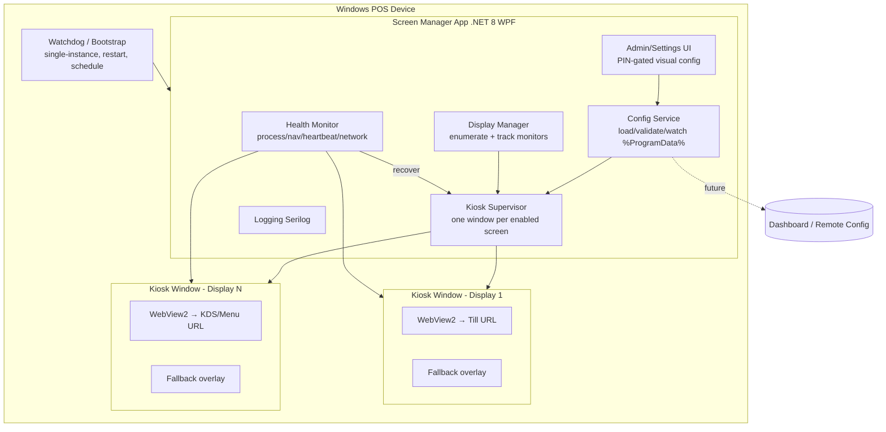
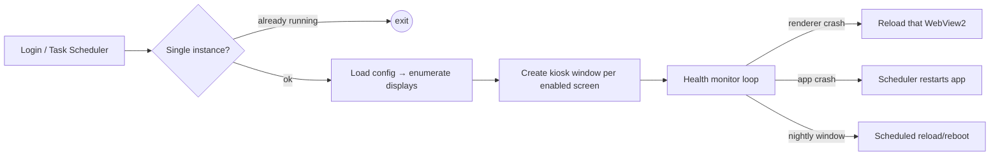
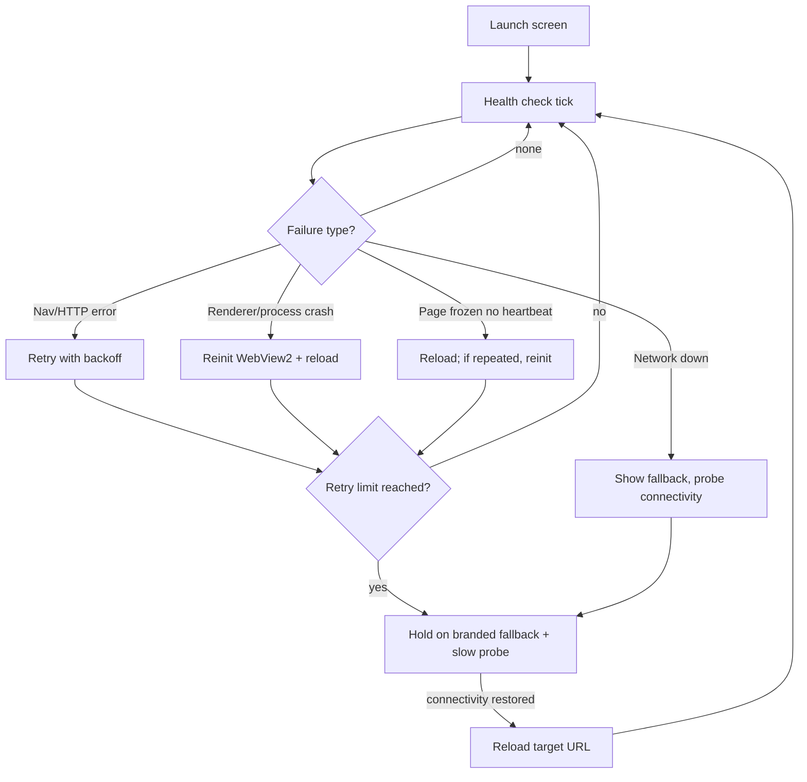

# OrderBuddy Screen Manager — v2 Design, Research & Development Plan

> **Status:** Research & design only. No application code in this deliverable.
> **Scope:** A lightweight, reliable, kiosk-style Windows application that launches and manages OrderBuddy/CutPay web apps (Till, Kiosk, Menu, KDS, Collection, Promo, and future apps) across one or more displays on unattended production devices.
> **Perspective:** This is a **clean-slate redesign**, not an evolution of v1 (`screen_runner`). Where v1 decisions caused pain, this document deliberately chooses a different path and explains why.

---

## 0. Why v2 is a clean slate (lessons from v1)

The existing v1 (`screen_runner`) is a Python 3.11 + **PySide6 / Qt WebEngine** app using a supervisor→worker process model, a single flat `settings.json`, a hidden top-left corner trigger for settings, and a TCP-ping network probe. It works, but has known problems: poor UX, inconsistent reliability, heavy runtime, and a settings model that is hard for non-technical staff.

| v1 pain point | Root cause | v2 direction |
|---|---|---|
| Bad, cramped settings UX | Qt Widgets dialog, screen-id strings, no visual layout | **Visual "display wall"** that mirrors the physical monitors + a first-run wizard |
| Heavy install / memory | Bundled Qt WebEngine ships its own Chromium (~150–250 MB) | **WebView2** shares the OS Evergreen Edge runtime (app stays small) |
| Chromium lags upstream | QtWebEngine tracks an older Chromium; security patches lag | **WebView2 auto-updates** with Edge (always-patched engine) |
| Recovery is coarse | TCP ping + supervisor restart only | **Layered health model**: process-failed events, navigation errors, JS heartbeat, network watchdog |
| Config fragile / hidden | Single JSON in app dir, obscure access | **Schema-validated config in `%ProgramData%`** with backup/restore + PIN-gated admin |
| Python packaging friction | PyInstaller onedir, large, AV false-positives | **Native .NET single-file** + signed MSI; smaller, faster startup |

**v2 headline recommendation:** **.NET 8 (LTS) + WPF host + WebView2 embedded browser**, single app process with an in-process watchdog, config in `%ProgramData%`, WiX/MSI installer, and a visual configuration experience. Rationale is developed throughout this document.

---

## 1. Industry research

### 1.1 The kiosk / digital-signage landscape
Reviewed categories and representative products to extract best practices (not to copy):

- **Dedicated kiosk browsers** (e.g. Porteus Kiosk, KioWare, SiteKiosk, Chrome/Edge "kiosk mode", WebView2 samples). Common traits: locked navigation, whitelisted domains, watchdog restart, remote config, tamper-resistant exit.
- **Digital-signage players** (e.g. Yodeck, ScreenCloud, Xibo, OptiSigns). Common traits: cloud-managed content, per-screen assignment, offline caching, scheduled reboots, heartbeat telemetry, fallback content.
- **Windows-native kiosk features**: Assigned Access / Shell Launcher (single-app kiosk), which we can *optionally* layer under our app for OS-level lockdown.

### 1.2 Best practices distilled
1. **One engine, auto-patched.** Use an evergreen browser engine you don't have to ship/patch yourself.
2. **Fail visible, recover invisible.** Never show a raw browser error; show branded fallback and self-heal.
3. **Layered watchdogs.** Distinguish *page* failure, *renderer/process* failure, *network* failure, and *app* failure — each needs a different recovery.
4. **Exponential backoff, never tight loops.** Cap retries, then hold on fallback and keep probing.
5. **Config is the product.** Non-technical staff succeed only if setup is visual, guided, and forgiving.
6. **Idempotent startup.** Single instance, auto-start on login, restart on crash, survive reboot/power loss.
7. **Scheduled hygiene.** Nightly reload/reboot window to clear memory leaks and stale sessions.
8. **Design for remote management even if you ship local-only first.** Keep config a serializable contract.

---

## 2. Technology evaluation

### 2.1 Embedded browser engine (the key decision)

| Criterion | **WebView2 (Chromium/Edge)** | CEF (Chromium Embedded) | Electron | Qt WebEngine (v1) | Native WebView (WebView2 predecessor / EdgeHTML) |
|---|---|---|---|---|---|
| App bundle size | **Tiny** (engine shared via OS Evergreen runtime) | Large (~150 MB bundled) | Large (~150 MB + Node) | Large (~200 MB) | Tiny |
| Memory footprint | **Low–moderate** (shared runtime) | Moderate–high | High | High | Low |
| Engine updates | **Automatic** via Edge/Evergreen | Manual (you ship updates) | Manual (you ship) | Manual (tied to Qt release) | Deprecated / frozen |
| Security patch latency | **Best** (Microsoft-maintained) | You own it | You own it | Lags upstream | Abandoned |
| Stability on kiosk | **High**, first-class Windows support | High but heavy | High but heavy | Adequate; multi-window quirks | Poor / legacy |
| Multi-window / multi-monitor | **Native, one WebView2 per window** | Supported | Heavy per-window cost | Supported (v1 pain) | Limited |
| Deployment ease | **Excellent** (runtime pre-installed on Win10/11 or bootstrapper) | Manual redistributables | Bulky installers | PyInstaller friction | N/A |
| Offline behaviour / caching | Full Chromium cache + custom handlers | Full | Full | Full | Limited |
| Crash isolation & telemetry | **`ProcessFailed`, `WebResourceResponseReceived`, nav events** | Callbacks | IPC | Signals | Weak |
| Licensing | Free, MS-supported | BSD (bundle obligations) | MIT (heavy) | LGPL/commercial nuance | N/A |

**Recommendation: Microsoft Edge WebView2.**
- Smallest footprint because the Chromium engine is the shared **Evergreen Runtime** already present on modern Windows 10/11 (and installable via a tiny bootstrapper otherwise).
- **Auto-patched** engine → best long-term security with zero maintenance.
- First-class Windows + .NET integration, per-window WebView2 controls map cleanly to per-monitor windows.
- Rich failure surface (`CoreWebView2.ProcessFailed`, navigation completed/failed, resource errors) enables precise recovery.
- Electron/CEF are rejected as **over-engineered and heavy** for a URL-launcher. Qt WebEngine (v1) is rejected for size, update lag, and past reliability issues.

> **Deployment note:** Ship the WebView2 **Evergreen Bootstrapper** (a few hundred KB) in the installer; it installs/repairs the runtime only if missing. Never bundle the fixed-version runtime unless a specific offline-imaging requirement forces it.

### 2.2 Host language & UI framework

| Option | Verdict |
|---|---|
| **.NET 8 (LTS) + WPF** | **Recommended.** Mature, stable, excellent multi-window & per-monitor-DPI support, huge ecosystem, clean MVVM for the config UI, first-class `Microsoft.Web.WebView2.Wpf` control, single-file publish, long-term support to Nov 2026 (move to .NET 10 LTS at next cycle). |
| .NET 8 + WinUI 3 | Modern look but still rough for multi-window unattended kiosk scenarios; more churn. Not chosen for reliability-first product. |
| .NET 8 + WinForms | Simplest, but dated UX and weaker DPI/layout story for the visual config we want. |
| C++/Win32 + WebView2 | Smallest/fastest but far higher dev cost and slower iteration. Not justified. |
| Continue Python/Qt (v1) | Rejected per §0. |

**Recommendation: .NET 8 LTS + WPF (MVVM) + WebView2.** Best balance of *lightweight*, *reliable*, *maintainable*, and *long-term support*, and it directly fixes v1's UX and packaging problems.

### 2.3 Supporting stack

| Concern | Recommendation | Why |
|---|---|---|
| Config storage | **JSON** (System.Text.Json) with a versioned schema, stored in `%ProgramData%\OrderBuddy\ScreenManager\config.json` | Human-readable, machine-writable, easy remote sync later, per-machine (not per-user) |
| Config protection | File ACL to Administrators + optional **DPAPI-encrypted** secrets section (PIN hash, tokens) | Prevents casual/unauthorised edits |
| Logging | **Serilog** → rolling file sink (`%ProgramData%\...\logs`) + optional Windows Event Log sink | Structured, rotation, levels, low overhead |
| Installer | **WiX Toolset v4 → MSI** (or MSIX if store/enterprise deployment desired) | Silent install, per-machine, service/registry setup, WebView2 bootstrapper chaining, code-signed |
| Auto-update | **Squirrel.Windows / Velopack** (delta updates) *or* MSI + a small updater that pulls signed packages | Unattended silent update with rollback; keep it simple and signed |
| Crash telemetry (optional) | Local structured logs first; pluggable sink for future dashboard | Aligns with future remote management without over-building now |
| Single instance | Named **Mutex** + optional Job Object | Prevents double launch |
| Startup | `HKLM\...\Run` (per-machine) or Scheduled Task (`At log on`, highest privileges, restart-on-fail) | Survive reboot; optional pre-login via service if truly required |

---

## 3. Architecture design

### 3.1 High-level architecture



### 3.2 Process & watchdog model (simpler than v1)

v1 used two Python processes (supervisor + worker). v2 keeps a **single app process** but adds a lightweight **watchdog** whose only job is liveness + restart, chosen from these options:

- **Option A (recommended): Scheduled Task watchdog.** A Windows Scheduled Task set to *run at log on*, *restart on failure* (e.g. every 1 min, up to N), *run with highest privileges*. The app writes a heartbeat file/timestamp; a tiny watchdog task (or the OS restart-on-fail policy) relaunches on crash. Minimal moving parts.
- **Option B: Windows Service watchdog** only if **pre-login** launch is a hard requirement (e.g. unattended reboot with no auto-logon). A service can start the UI session app via the active console session. More complex; add only if operationally justified.

Inside the app, crash isolation comes from **WebView2's own multi-process model** — a renderer crash raises `ProcessFailed` and is recovered by reloading that single window, *without* taking down the app. This removes v1's need for a heavyweight external worker just to survive renderer crashes.



### 3.3 Multi-display management

- Enumerate displays via `System.Windows.Forms.Screen` / Win32 `EnumDisplayMonitors` and subscribe to **`WM_DISPLAYCHANGE`** + device notifications to react to hot-plug/unplug at runtime.
- **Stable identity:** map config to a monitor by a **stable key** (device path / EDID target ID) rather than ordinal index, so re-plugging or reorder doesn't scramble assignments. Fall back to position + resolution when EDID is unavailable.
- Each enabled screen = one **borderless top-most window** placed on its target monitor's bounds, hosting one WebView2.
- Per-screen config: name, target display, app type, URL, startup behaviour, full-screen, rotation/orientation, resolution (read-only), enable/disable.
- **Runtime display changes** (edge case coverage): on monitor removed → gracefully hide/close that window and log; on monitor added → offer to auto-create a window if a saved assignment matches, else leave disabled until configured; on reorder → re-bind by stable key, not index.

### 3.4 Browser hosting & kiosk enforcement

Each kiosk window applies:
- Borderless, no chrome, full-screen on target monitor bounds, top-most.
- WebView2 configured to **disable**: context menu, dev tools, default error page, status bar, browser accelerator keys, new-window popups (redirect to same or block), Ctrl+ scroll zoom (unless per-screen zoom set), pinch-zoom (unless allowed), swipe navigation, F5/back/forward as needed.
- **Navigation lockdown:** optional domain allow-list; block/redirect off-list navigations; block `about:`, `file:` unless whitelisted.
- Autoplay/media/geolocation/notification permissions auto-granted per-screen (carry the useful v1 behaviours).
- Custom, branded **fallback overlay** rendered *in-app* (WPF layer over the WebView2), not a web page — so it works even when the network is fully down.

### 3.5 Recovery architecture (layered)



**Failure taxonomy & response:**

| Failure | Detection | Response |
|---|---|---|
| Page/URL/HTTP error | `NavigationCompleted (IsSuccess=false)`, HTTP status via resource events | Retry with **exponential backoff** (e.g. 5s→10s→30s→60s, cap), then fallback overlay + slow probe |
| Renderer/process crash | `CoreWebView2.ProcessFailed` | Recreate WebView2 for that window and reload; count failures |
| Rendering freeze / hang | **JS heartbeat** (injected script posts a message every N s) missing | Reload; if repeated, reinit WebView2 |
| Network offline | Connectivity watchdog (see §5) | Fallback overlay, keep probing, auto-reload on restore |
| App crash | Watchdog / Scheduled Task | Restart app, restore all windows from config |
| Memory bloat | Optional working-set watchdog + nightly reload | Reload window or restart at scheduled quiet time |

**Anti-thrash rule:** all retries use capped exponential backoff; never a tight loop. After the cap, the window *holds on fallback* and switches to a slow connectivity probe (e.g. every 15–30s).

### 3.6 Configuration schema (draft)

```jsonc
{
  "schemaVersion": 2,
  "device": {
    "deviceName": "STORE12-TILL-PC",
    "deviceId": "auto-guid",
    "storeId": "",
    "organizationId": "",
    "appVersion": "2.0.0"
  },
  "general": {
    "autoStartOnLogin": true,
    "autoReconnect": true,
    "retryBackoffSec": [5, 10, 30, 60],
    "offlineTimeoutSec": 20,
    "logLevel": "Information",
    "cache": { "enabled": true, "clearOnUpdate": true },
    "nightlyMaintenance": { "enabled": true, "time": "03:30", "action": "reloadAll" },
    "adminPinHash": "dpapi-or-pbkdf2-protected"
  },
  "screens": [
    {
      "id": "guid",
      "enabled": true,
      "name": "POS Till",
      "displayKey": "EDID/target-id-or-devicepath",
      "displayNumberHint": 1,
      "appType": "Till",              // Till | Kiosk | Menu | KDS | Collection | Promo | Custom
      "url": "https://till.orderbuddy.example/site/12",
      "startupDelaySec": 0,
      "reloadIntervalSec": 0,
      "fullScreen": true,
      "rotationDegrees": 0,
      "zoomPercent": 100,
      "allowedDomains": [],
      "fallback": { "mode": "branded", "customHtmlPath": "", "imagePath": "" }
    }
  ]
}
```

Config service responsibilities: **load → validate against schema → migrate old versions → atomic write (temp+rename) → keep last-known-good backup → hot-reload on change**. A corrupted file falls back to the last-known-good copy and logs loudly (edge-case coverage).

---

## 4. UI/UX proposal (fresh perspective, not v1)

Design goals: **visual, guided, forgiving, touch-first, few steps.** The centrepiece is a **Display Wall** that mirrors the physical monitors so a non-technical installer literally sees what they're configuring.

### 4.1 Admin access workflow (touch-only friendly + keyboard)

Recommended **multi-path, PIN-gated** access (any path opens the same PIN prompt):
1. **Hidden gesture (primary for touch):** tap a fixed **corner** (e.g. top-right) **5 times within 3 seconds**, *or* a **long-press (3s) with two fingers**. Discoverable only to trained staff.
2. **Keyboard shortcut (for equipped devices):** `Ctrl + Shift + F12` (configurable).
3. Both funnel into a **numeric PIN pad** (on-screen, touch-sized). PIN is stored as a salted **PBKDF2 hash** (or DPAPI-protected). Lockout with backoff after repeated failures.

> Rationale: obscurity (v1's hidden corner) is not security. v2 keeps a discoverable *trigger* but adds a real *PIN gate*, satisfying both touch-only and keyboard devices.

### 4.2 First-run setup wizard (the big UX win)

```
┌────────────────────────────────────────────────────────────┐
│  OrderBuddy Screen Manager — Setup (Step 2 of 5)           │
│                                                            │
│  Device                                                    │
│   Device name  [ STORE12-TILL-PC        ]                  │
│   Store ID     [ 12 ]   Org ID [ ORD-9981 ]                │
│                                                            │
│  Detected displays:                                        │
│   ┌──────────┐   ┌──────────┐   ┌──────────┐              │
│   │ Display 1│   │ Display 2│   │ Display 3│              │
│   │ 1920x1080│   │ 1080x1920│   │ 1920x1080│              │
│   │  ● Till  │   │  ○ pick  │   │  ○ pick  │              │
│   └──────────┘   └──────────┘   └──────────┘              │
│                                                            │
│         [ Identify screens ]        [ Back ]  [ Next ]     │
└────────────────────────────────────────────────────────────┘
```

Wizard steps: **Welcome → Device info → Assign displays (Display Wall) → URLs & options → Review & finish → Lock into kiosk.** "Identify screens" flashes a big number on each monitor (kept from v1, improved).

### 4.3 Display Wall — main config screen

```
┌────────────────────────────────────────────────────────────────┐
│  Screen Manager · Settings                    [Device] [Save]  │
│  ───────────────────────────────────────────────────────────  │
│   Physical layout (drag to assign)                            │
│                                                                │
│     ┌───────────┐ ┌───────────┐ ┌───────────┐                 │
│     │ DISPLAY 1 │ │ DISPLAY 2 │ │ DISPLAY 3 │                 │
│     │  POS Till │ │  Kitchen  │ │   Menu    │                 │
│     │  ● online │ │  ● online │ │  ○ offline│                 │
│     └───────────┘ └───────────┘ └───────────┘                 │
│                                                                │
│   Selected: Display 2 — Kitchen Display                       │
│   App type [ KDS ▾ ]   Enabled [✓]   Full-screen [✓]         │
│   URL      [ https://kds.orderbuddy.example/site/12      ]    │
│   Rotation [ 0° ▾ ]  Zoom [100%]  Reload every [ 0 ] sec      │
│   Startup delay [ 0 ] sec     Fallback [ Branded ▾ ]         │
│                                                                │
│   [ Test URL ]   [ Reload ]   [ Open live ]                   │
└────────────────────────────────────────────────────────────────┘
```

- **App-type presets** pre-fill sensible defaults (e.g. KDS = no zoom, no popups; Menu = autoplay media on, longer reload).
- Live **status dots** per screen (online/offline/recovering).
- **Test URL** validates reachability + SSL before saving.
- Tabs: **Displays · General · Advanced · Diagnostics · About**.

### 4.4 General & diagnostics
- **General:** auto-start, auto-reconnect, retry/backoff, offline timeout, nightly maintenance window, logging level, cache.
- **Diagnostics:** live per-screen state, last error, uptime, memory, "view logs", "export support bundle", connectivity test, "restart all screens".

### 4.5 Fallback screen (branded, in-app)

```
┌────────────────────────────────────────────────────────────┐
│                                                            │
│                   [ OrderBuddy logo ]                      │
│                                                            │
│            Reconnecting to Kitchen Display…               │
│                                                            │
│   Device: STORE12-KDS-PC   ·   Screen: KDS (Display 2)    │
│   Connection: OFFLINE                                      │
│   Last connected: 14:52  ·  Retry in: 12s                 │
│                                                            │
│              ▓▓▓▓▓▓▓░░░░░░  attempting…                    │
└────────────────────────────────────────────────────────────┘
```

Auto-dismisses on reconnect; shows device/screen/connection/last-connected/retry countdown/branding. Rendered by WPF (works with zero network).

---

## 5. Feature specifications (mapped to requirements)

| Requirement | v2 approach |
|---|---|
| **Kiosk mode** | Borderless top-most full-screen WebView2; all browser UI/keys/context menu disabled; optional OS-level Assigned Access/Shell Launcher layer for hardened sites |
| **Prevent accidental exit** | No close affordance; global hotkeys swallowed; exit only via admin PIN; optional block of Alt+F4/Win keys |
| **Secure settings** | Corner-gesture OR `Ctrl+Shift+F12` → **PIN pad** (PBKDF2/DPAPI hash, lockout) |
| **Multi-monitor** | Stable-key display binding, hot-plug aware, per-screen window & config |
| **Auto recovery** | Layered health model (§3.5) with capped backoff |
| **Fallback screen** | Branded in-app overlay (§4.5) |
| **Health monitoring** | `ProcessFailed`, navigation/HTTP results, **JS heartbeat**, connectivity watchdog, optional memory watchdog |
| **Offline behaviour** | Detect via lightweight HTTP HEAD to a health endpoint + local TCP probe; show fallback; auto-reload on restore; distinguish *internet down* vs *local server down* vs *dashboard down* |
| **Startup integration** | Per-machine Run key or Scheduled Task (log-on, restart-on-fail, highest privileges); single-instance mutex; optional service for pre-login |
| **Remote config (future)** | Config is a serializable contract; add a pull-based sync client + device registration later without architectural change |
| **Cache maintenance** | Admin-configurable interval (default 60 min) + on-demand clear via `CoreWebView2.Profile.ClearBrowsingDataAsync`; two scopes (`cacheOnly` / `cacheAndSession`); see §5.2 |
| **Kiosk auto-login** | Per-screen saved credentials (username + DPAPI-encrypted password); origin-gated `request-credentials`→`credentials` WebView2 handshake so the web app re-authenticates after a cache clear; see §5.2 |
| **Security** | ACL'd config in `%ProgramData%`, DPAPI-protected secrets, domain allow-list, PIN-gated admin, signed installer & updates |

### 5.1 Offline detection detail
Three independent signals, logged distinctly:
1. **Internet**: TCP/HTTP probe to a public target (e.g. `https://www.msftconnecttest.com/connecttest.txt` or configurable) — carry v1's DNS-probe idea but prefer HTTP to detect captive portals.
2. **Local server**: HEAD to the configured app origin.
3. **Dashboard** (future): HEAD to management endpoint.
Fallback messaging names the *specific* outage. Auto-reload triggers only when the *relevant* signal recovers.

### 5.2 Cache maintenance & kiosk auto-login (P13)

**Problem:** in the field, a web app periodically misbehaves and the only known fix is to clear the browser cache and log back in. P13 automates both halves so the device self-heals unattended. Tracked as Phase P13 in [DEVELOPMENT_PLAN.md](DEVELOPMENT_PLAN.md).

#### 5.2.1 Cache maintenance
- **Shared profile:** all kiosk windows reuse one `CoreWebView2Environment`/user-data folder (`%ProgramData%\OrderBuddy\ScreenManager\webview2`), so a single `CoreWebView2.Profile.ClearBrowsingDataAsync(...)` clears the whole profile. (One screen per device in current deployment, but the supervisor loop stays generic.)
- **Two admin-selectable scopes:**
  - `cacheOnly` → `DiskCache | CacheStorage` — fixes stale-asset/memory bloat, **keeps login**.
  - `cacheAndSession` → also `Cookies | AllDomStorage` — logs the session out, which then triggers auto-login (§5.2.2).
- **Triggers:** (a) `CacheMaintenanceScheduler` — an admin-configurable interval timer (default 60 min, guarded ≥ 5), modeled on `NightlyMaintenanceScheduler`; (b) an on-demand **"Clear cache now"** admin button. A re-entrancy guard prevents timer/manual overlap. Clear is followed by a reload when `reloadAfterClear` is set.

#### 5.2.2 Kiosk auto-login
- **Storage:** per-screen `ScreenCredentials` = `AutoLoginEnabled`, `Username`, `EncryptedPassword`. The password is **DPAPI-encrypted (LocalMachine scope)** at rest via a new `AdminCredentialsService`; the plaintext password is **never** persisted or logged. Config already lives in ACL'd `%ProgramData%`.
- **Delivery handshake** (over the existing WebView2 `WebMessageReceived` channel):
  1. Page (when logged out) posts `{ "type": "request-credentials" }`.
  2. Host verifies the WebView's top-level origin matches the screen's configured URL host (**allow-list gate**) and that auto-login is enabled with stored credentials.
  3. Host decrypts and replies to that WebView only: `PostWebMessageAsJson({ "type": "credentials", "username": "...", "password": "..." })`.
  4. Page fills its login form / calls its login endpoint and submits.
- **Simplicity note:** raw username/password pass-through is intentional for now (no token exchange). A future hardening option is a one-time login token / dedicated auto-login endpoint so the raw password never enters the DOM — deferred until the web backend supports it.

#### 5.2.3 Combined self-heal flow
Hourly `cacheAndSession` clear → reload → page detects logged-out → `request-credentials` → origin-gated host response → web app auto-logs-in, with zero operator action.

#### 5.2.4 Config schema additions (schemaVersion 2 → 3)
```jsonc
"general": {
  "cacheMaintenance": {
    "enabled": true,
    "intervalMinutes": 60,
    "scope": "cacheAndSession",   // "cacheOnly" | "cacheAndSession"
    "reloadAfterClear": true
  }
},
"screens": [{
  "credentials": {
    "autoLoginEnabled": false,
    "username": "",
    "encryptedPassword": ""       // DPAPI (LocalMachine) blob, base64
  }
}]
```
A `ConfigMigrator` step fills defaults for older files; the validator clamps `intervalMinutes` to the minimum and rejects unknown `scope` values. Credentials are excluded from the support-bundle export and all log sinks.

---

## 6. Edge cases & recovery strategies

| Scenario | Strategy |
|---|---|
| Monitor disconnected while running | Detect `WM_DISPLAYCHANGE`; close/hide that window; keep assignment; log; auto-restore window when monitor returns |
| Monitor added after startup | If a saved assignment matches the display key → auto-open window; else prompt in admin, keep disabled meanwhile |
| Display order changes | Bind by **stable display key (EDID/device path)**, never ordinal index |
| Invalid URL | Validate on save (**Test URL**); at runtime show fallback + log; don't crash |
| SSL certificate errors | Default **reject** and show fallback; per-screen opt-in "allow insecure" (admin, logged) for internal/self-signed |
| Slow network | Navigation timeout → fallback with "still loading" state; don't retry-thrash |
| Temporary server outage | Backoff retries → fallback → slow probe → auto-reload on recovery |
| Browser/renderer crash | `ProcessFailed` → reinit that WebView2 + reload; per-window failure counter |
| Windows sleep/resume | On resume, re-validate displays, reconnect, reload stale pages, reassert top-most |
| Power failure | Task Scheduler at log-on + restart-on-fail restores all screens from persisted config |
| Auto app restart | Single-instance mutex; watchdog relaunch; deterministic restore from config |
| Corrupted config | Schema validation → fall back to **last-known-good** backup → safe defaults → loud log; never brick the device |
| Config write interrupted | **Atomic write** (temp file + rename) prevents partial/corrupt saves |
| WebView2 runtime missing | Installer bootstrapper installs/repairs; app shows guided message if absent |

---

## 7. Development plan

### 7.1 Milestones / roadmap

| Milestone | Deliverable | Exit criteria |
|---|---|---|
| **M0 — Spike** | .NET 8 WPF + WebView2 single borderless full-screen window loading a URL | Renders a URL full-screen on chosen monitor; `ProcessFailed` reload proven |
| **M1 — Multi-display core** | Display enumeration, stable-key binding, one window per enabled screen, config load/save | 3+ monitors each show distinct URLs from config; survives reorder |
| **M2 — Kiosk lockdown** | Disable chrome/keys/context menu/popups; single instance; auto-start | Cannot exit without PIN; auto-starts on login; single instance enforced |
| **M3 — Recovery & health** | Layered health monitor, backoff retries, JS heartbeat, connectivity watchdog | Injected failures (kill renderer, pull network, bad URL) recover automatically without thrash |
| **M4 — Fallback & offline** | Branded in-app fallback overlay; offline signal separation; auto-reload on restore | Fallback shows correct cause; auto-recovers on reconnect |
| **M5 — Admin UX** | PIN-gated access, first-run wizard, Display Wall, Test URL, diagnostics | Non-technical user configures a 3-screen device unaided in a usability test |
| **M6 — Packaging** | WiX MSI + WebView2 bootstrapper, code signing, Scheduled Task/Run setup | Silent install/uninstall/upgrade; clean device boots into kiosk |
| **M7 — Update & hardening** | Auto-update (Velopack/Squirrel) with rollback; security pass; nightly maintenance | Signed delta update applies unattended; rollback verified |
| **M8 — Remote-ready (optional)** | Config sync client + device registration hooks (behind a flag) | Device can pull config from an endpoint; no regression when disabled |

### 7.2 Dependencies
- WebView2 Evergreen Runtime (bootstrapper) · .NET 8 SDK/runtime · `Microsoft.Web.WebView2` · Serilog · WiX v4 · code-signing certificate · Velopack/Squirrel (update) · test devices (1/2/3-monitor, touch-only + keyboard).

### 7.3 Risk assessment

| Risk | Likelihood | Impact | Mitigation |
|---|---|---|---|
| WebView2 runtime absent on old images | Med | High | Bundle bootstrapper; detect + guided repair |
| Display hot-plug identity instability | Med | Med | Stable EDID/device-path keys + position fallback |
| Retry storms / CPU spin | Low | High | Capped exponential backoff, enforced by design |
| AV false-positive on installer | Med | Med | **Code-sign** binaries + installer; reputation build-up |
| Memory leaks in long-running web apps | Med | Med | Memory watchdog + nightly reload/reboot window |
| Pre-login launch requirement emerges | Low | Med | Service watchdog option kept in design (Option B) |
| Scope creep toward remote mgmt too early | Med | Med | Keep remote behind a flag; ship local-first |

---

## 8. Validation & testing checklist

### 8.1 Displays
- [ ] Single display: correct URL, full-screen, borderless, top-most.
- [ ] Two/three/four displays: each shows its assigned app type & URL.
- [ ] Portrait + rotated monitor renders correctly.
- [ ] Mixed resolutions/DPI render crisply (per-monitor DPI).
- [ ] Monitor unplugged at runtime → window handled, assignment retained, log written.
- [ ] Monitor re-plugged → window auto-restores to correct assignment (by stable key).
- [ ] Display reorder → assignments stay correct (no scramble).

### 8.2 Kiosk & security
- [ ] No browser chrome, address bar, nav buttons, context menu, dev tools.
- [ ] Alt+F4 / Win / F5 / back-forward suppressed as configured.
- [ ] Cannot exit without admin PIN.
- [ ] Corner-gesture opens PIN pad (touch-only device).
- [ ] `Ctrl+Shift+F12` opens PIN pad (keyboard device).
- [ ] Wrong PIN lockout/backoff works; PIN hash not stored in plaintext.
- [ ] Domain allow-list blocks off-list navigation.
- [ ] Config file ACL prevents non-admin edits; secrets protected.

### 8.3 Recovery
- [ ] Bad URL → branded fallback, backoff retries, no thrash.
- [ ] Kill WebView2 renderer → single window recovers, app stays up.
- [ ] Frozen page (no heartbeat) → auto reload.
- [ ] App killed → watchdog/Task restarts and restores all screens.
- [ ] SSL error → rejected + fallback (and opt-in allow works when enabled).
- [ ] Repeated failures escalate correctly then hold on slow probe.

### 8.4 Offline & network
- [ ] Internet down → fallback names "internet"; auto-reload on restore.
- [ ] Local server down (internet up) → fallback names "server"; auto-reload on restore.
- [ ] Slow network → "loading" state, no premature error.
- [ ] Captive portal detected (HTTP probe) not treated as online.

### 8.5 Startup & lifecycle
- [ ] Auto-start on login brings up all screens.
- [ ] Single-instance: second launch is a no-op.
- [ ] Windows restart → device returns to kiosk unattended.
- [ ] Simulated power loss → clean recovery from persisted config.
- [ ] Sleep/resume → displays revalidated, pages reloaded, top-most reasserted.
- [ ] Nightly maintenance window reloads/reboots as configured.

### 8.6 Config & UX
- [ ] First-run wizard completes a 3-screen setup by a non-technical tester.
- [ ] "Identify screens" flashes correct numbers.
- [ ] Test URL validates reachability + SSL before save.
- [ ] Corrupted config → last-known-good restore, device still boots.
- [ ] Interrupted save (kill mid-write) → no corruption (atomic write).
- [ ] Config schema migration from older version succeeds.

### 8.7 Packaging & update
- [ ] Silent MSI install/uninstall/upgrade.
- [ ] WebView2 bootstrapper installs runtime when missing.
- [ ] Binaries + installer code-signed; no AV false-positive on target images.
- [ ] Auto-update applies unattended; rollback works.

### 8.8 Performance & resource use
- [ ] Cold start to first pixel within target (e.g. < 5 s on baseline hardware).
- [ ] Idle memory within target per screen; no unbounded growth over 72 h soak.
- [ ] CPU near-idle when pages are static; no retry-loop spin.
- [ ] 72-hour multi-screen soak test passes with automated fault injection.

---

## 9. Summary of recommendations

1. **Clean-slate v2** on **.NET 8 LTS + WPF + WebView2** — small, fast, reliable, well-supported; fixes v1's UX, size, and update-lag problems.
2. **WebView2** as the engine (evergreen, auto-patched, low footprint) — reject Electron/CEF (heavy) and Qt WebEngine (v1's pain).
3. **Single app process + WebView2 multi-process isolation + a Scheduled-Task watchdog** — simpler and more robust than v1's Python supervisor/worker.
4. **Visual, guided config** (first-run wizard + Display Wall + PIN-gated admin) — the biggest user-facing improvement over v1.
5. **Layered recovery with capped backoff** and a **branded in-app fallback** — maximise uptime, never show raw errors, never thrash.
6. **Schema-validated config in `%ProgramData%`** with atomic writes, last-known-good backup, and a serializable contract that keeps **remote management** a future drop-in.
7. **Signed WiX/MSI + WebView2 bootstrapper + auto-update** for painless, unattended deployment.

> Next step (on approval): stand up **M0 spike** — a .NET 8 WPF window hosting WebView2 full-screen on a chosen monitor with `ProcessFailed` auto-reload — to validate the stack before building out.
```
