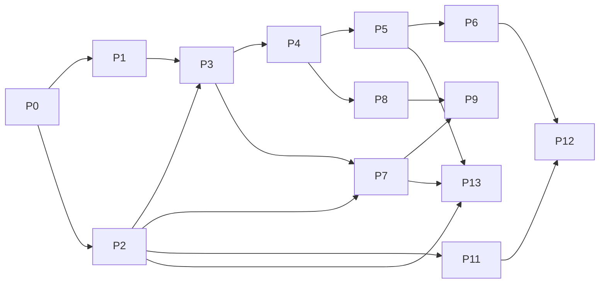

# OrderBuddy Screen Manager — v2 Development Plan (Tracking)

> **Purpose:** A granular, checkbox-driven execution plan to build v2 from zero to production. Companion to [DESIGN.md](DESIGN.md).
> **How to use:** Work top-to-bottom by phase. Tick each task `[x]` when its acceptance criteria pass. Keep the **Progress Dashboard** (§1) and **Change Log** (§13) current. Do not start a phase until its listed dependencies are done.
> **Legend:** ☐ not started · ◐ in progress · ☑ done · ⚠ blocked. Priority: **P0** critical path · **P1** important · **P2** nice-to-have.

---

## 1. Progress dashboard

| Phase | Focus | Tasks | Status | Exit gate |
|---|---|---:|---|---|
| P0 | Project bootstrap & tooling | 6 | ☑ 6/6 | Repo builds & runs empty WPF app |
| P1 | Spike: WebView2 kiosk window | 7 | ☑ 7/7 | URL renders full-screen + reload on crash |
| P2 | Config service & schema | 8 | ☑ 8/8 | Load/validate/save/migrate/backup proven |
| P3 | Multi-display core | 8 | ☑ 8/8 | N monitors → N windows, stable-key binding |
| P4 | Kiosk lockdown & security | 9 | ☑ 9/9 | Cannot exit; nav locked; single instance |
| P5 | Health monitoring & recovery | 9 | ☑ 9/9 | All injected faults self-heal, no thrash |
| P6 | Fallback & offline behaviour | 7 | ☑ 7/7 | Branded fallback + correct offline cause |
| P7 | Admin UX (wizard + Display Wall) | 10 | ☑ 10/10 | Non-tech user configures 3 screens unaided |
| P8 | Startup integration & lifecycle | 6 | ☑ 6/6 | Auto-start, restart-on-crash, sleep/resume |
| P9 | Packaging & installer | 7 | ☑ 7/7 | Silent MSI + WebView2 deploy script |
| P10 | Auto-update & hardening | 6 | ⚠ deferred | Post-release hardening, not needed for local-first deployment |
| P11 | Remote-ready hooks (optional) | 5 | ☐ 0/5 | Config pull behind flag, no regression |
| P12 | QA, soak & release | 8 | ☐ 0/8 | Full test matrix green; 72h soak passes |
| P13 | Cache maintenance & kiosk auto-login | 15 | ☑ 15/15 | Hourly+manual cache clear; saved creds auto-login |
| **Total** | | **111** | **◐ 92/111** | Production release |

> Update the counts as tasks complete (e.g. `◐ 3/8`).
> Current scope decision: for a local-first kiosk deployment on tills and other screens, **P10 is deferred**. A usable release target is **P9 complete + targeted P12 validation**, with manual deployment/signing handled separately as needed.

---

## 2. Definition of Done (applies to every task)
- [ ] Code compiles with no warnings introduced.
- [ ] Behaviour matches the task's acceptance criteria.
- [ ] Logged appropriately (Serilog) with correct level.
- [ ] Manual verification steps executed on at least one real/VM device.
- [ ] No regressions in the phase's exit-gate scenario.
- [ ] Config/docs updated if behaviour or schema changed.

---

## 3. Phase P0 — Project bootstrap & tooling  `depends: none`

**Goal:** A clean, buildable .NET 8 WPF solution with logging, DI, and repo hygiene.

- [x] **P0-1 (P0)** Create solution `OrderBuddy.ScreenManager.sln`; projects: `ScreenManager.App` (WPF, net8.0-windows), `ScreenManager.Core` (class lib), `ScreenManager.Tests` (xUnit).
  - *Accept:* `dotnet build` succeeds; empty WPF window shows.
- [x] **P0-2 (P0)** Add NuGet deps: `Microsoft.Web.WebView2`, `Serilog`, `Serilog.Sinks.File`, `Serilog.Sinks.EventLog`, `Microsoft.Extensions.Hosting` (DI/host), `System.Text.Json`.
  - *Accept:* restore succeeds; versions pinned in `Directory.Packages.props`.
- [x] **P0-3 (P0)** Set up generic host + DI container; register `IConfigService`, `IDisplayManager`, `IHealthMonitor`, `ILogger` placeholders.
  - *Accept:* app starts via host; DI resolves stubs.
- [x] **P0-4 (P1)** Configure Serilog: rolling file to `%ProgramData%\OrderBuddy\ScreenManager\logs`, level from config, Event Log sink for errors.
  - *Accept:* startup writes a log line; file rotates by day/size.
- [x] **P0-5 (P1)** Repo hygiene: `.gitignore` (bin/obj/publish), `.editorconfig`, `Directory.Build.props` (nullable enable, LangVersion, versioning), README stub.
  - *Accept:* clean `git status` after build; analyzers on.
- [x] **P0-6 (P2)** CI stub (GitHub Actions / local script): restore → build → test.
  - *Accept:* pipeline/script runs green on empty tests.

**Exit gate:** solution builds and runs an empty WPF window with logging active.

---

## 4. Phase P1 — Spike: WebView2 kiosk window  `depends: P0`

**Goal:** Prove the core stack — a borderless full-screen WebView2 that loads a URL and survives a renderer crash.

- [x] **P1-1 (P0)** `KioskWindow` (WPF): borderless (`WindowStyle=None`), no resize, top-most, full-screen on primary monitor.
  - *Accept:* window covers one monitor edge-to-edge, no chrome.
- [x] **P1-2 (P0)** Host `WebView2` control filling the window; init `CoreWebView2` with a per-app user-data folder under `%ProgramData%`.
  - *Accept:* a hard-coded URL renders full-screen.
- [x] **P1-3 (P0)** Handle `CoreWebView2.ProcessFailed`: log, then recreate/reload WebView2.
  - *Accept:* killing the WebView2 renderer process auto-recovers the page.
- [x] **P1-4 (P1)** Handle `NavigationCompleted`: capture success/failure + web error status.
  - *Accept:* bad URL logs a navigation failure with status.
- [x] **P1-5 (P1)** Disable default context menu, dev tools, status bar, zoom-by-ctrl-scroll via `CoreWebView2Settings`.
  - *Accept:* right-click shows nothing; F12 does nothing.
- [x] **P1-6 (P1)** Verify autoplay media works (no gesture requirement) via launch args/settings.
  - *Accept:* a test autoplay video plays without interaction.
- [x] **P1-7 (P2)** Measure cold-start time and idle memory; record baseline in Change Log.
  - *Accept:* numbers recorded for later comparison.

**Exit gate:** URL renders full-screen; renderer crash auto-recovers.

---

## 5. Phase P2 — Config service & schema  `depends: P0`

**Goal:** Robust, versioned configuration with validation, atomic writes, backup, migration, hot-reload. Schema per DESIGN §3.6.

- [x] **P2-1 (P0)** Define POCO models: `AppConfig`, `DeviceInfo`, `GeneralSettings`, `ScreenConfig`, `FallbackConfig`, `AppType` enum.
  - *Accept:* serializes/deserializes round-trip with `System.Text.Json`.
- [x] **P2-2 (P0)** `IConfigService.Load()`: read from `%ProgramData%\OrderBuddy\ScreenManager\config.json`; create defaults if missing.
  - *Accept:* first run writes a valid default config.
- [x] **P2-3 (P0)** Schema validation (required fields, URL format, ranges); collect errors, don't throw on minor issues.
  - *Accept:* invalid values reported; safe defaults substituted.
- [x] **P2-4 (P0)** Atomic save (write temp file + `File.Replace`/rename); never leave partial file.
  - *Accept:* killing process mid-save leaves prior config intact.
- [x] **P2-5 (P0)** Last-known-good backup: keep `config.bak`; on corrupt load, restore from backup then defaults.
  - *Accept:* corrupt `config.json` → app boots from backup, logs loudly.
- [x] **P2-6 (P1)** Version migration pipeline (`schemaVersion` upgrader chain).
  - *Accept:* a v1-shaped file migrates to current schema.
- [x] **P2-7 (P1)** Hot-reload via `FileSystemWatcher` (debounced); raise `ConfigChanged`.
  - *Accept:* external edit re-applies without restart.
- [x] **P2-8 (P1)** Secrets protection: PIN hash via PBKDF2 (salted) or DPAPI; secrets section not plaintext.
  - *Accept:* config file contains no plaintext PIN.

**Exit gate:** load/validate/save/migrate/backup/hot-reload all proven by tests.

---

## 6. Phase P3 — Multi-display core  `depends: P1, P2`

**Goal:** Enumerate monitors, bind by stable key, one window per enabled screen, react to hot-plug.

- [x] **P3-1 (P0)** `IDisplayManager.Enumerate()`: list monitors with bounds, work area, DPI, resolution, orientation.
  - *Accept:* returns correct data on a multi-monitor machine.
- [x] **P3-2 (P0)** Derive **stable display key** (EDID target id / device path) with position+resolution fallback.
  - *Accept:* same monitor yields same key across reboots/replug.
- [x] **P3-3 (P0)** `KioskSupervisor`: create one `KioskWindow` per enabled screen, placed on its target monitor bounds.
  - *Accept:* 3 monitors → 3 windows, each on the right screen with the right URL.
- [x] **P3-4 (P0)** Bind config `displayKey` → live monitor; unmatched enabled screens show fallback "waiting for display".
  - *Accept:* assignments follow the monitor, not the index.
- [x] **P3-5 (P1)** Subscribe to `WM_DISPLAYCHANGE` / display device notifications.
  - *Accept:* plug/unplug fires an event within ~1s.
- [x] **P3-6 (P1)** Monitor removed at runtime → close/hide that window, retain assignment, log.
  - *Accept:* unplugging a monitor doesn't crash; others unaffected.
- [x] **P3-7 (P1)** Monitor added at runtime → auto-open window if saved assignment matches, else leave for admin.
  - *Accept:* replugging restores the correct window automatically.
- [x] **P3-8 (P1)** Per-screen rotation/orientation + zoom applied at window/WebView2 level.
  - *Accept:* a portrait screen and a zoomed screen render correctly.

**Exit gate:** N monitors → N correctly-bound windows; survives reorder/replug.

---

## 7. Phase P4 — Kiosk lockdown & security  `depends: P3`

**Goal:** Make the kiosk tamper-resistant; prevent accidental exit; lock navigation; single instance.

- [x] **P4-1 (P0)** Single-instance guard via named `Mutex`; second launch exits quietly (log).
  - *Accept:* launching twice yields one running instance.
- [x] **P4-2 (P0)** Suppress browser accelerator keys (F5, Ctrl+R, back/forward, Ctrl+P unless allowed) via WebView2 accelerator-key handler.
  - *Accept:* those keys do nothing in kiosk mode.
- [x] **P4-3 (P0)** Block Alt+F4 / close; intercept `Window.Closing` unless admin-authorised exit.
  - *Accept:* Alt+F4 does not close kiosk windows.
- [x] **P4-4 (P0)** Global low-level keyboard hook (optional, config-gated) to swallow Win key / Ctrl+Esc.
  - *Accept:* Win key doesn't drop to desktop when enabled.
- [x] **P4-5 (P0)** Navigation lockdown: optional domain allow-list; block/redirect off-list + `file:`/`about:`.
  - *Accept:* off-list link is blocked and logged.
- [x] **P4-6 (P0)** New-window/popup policy: redirect to same window or block per config.
  - *Accept:* `target=_blank` doesn't spawn an uncontrolled window.
- [x] **P4-7 (P1)** Per-screen permission auto-grant (media/geo/notification/clipboard) via `PermissionRequested`.
  - *Accept:* camera/mic/geo prompts auto-resolve per config.
- [x] **P4-8 (P1)** Config file ACL: restrict write to Administrators/SYSTEM.
  - *Accept:* standard user cannot modify config file.
- [x] **P4-9 (P1)** SSL/cert error policy: reject by default; per-screen opt-in "allow insecure" (logged).
  - *Accept:* self-signed site blocked unless opted-in.

**Exit gate:** cannot exit or navigate away without authorisation; one instance only.

---

## 8. Phase P5 — Health monitoring & recovery  `depends: P4`

**Goal:** Layered detection + capped-backoff recovery for every failure class (DESIGN §3.5).

- [x] **P5-1 (P0)** `IHealthMonitor` per screen: track state (Loading/Online/Recovering/Offline/Failed).
  - *Accept:* state transitions logged and queryable.
- [x] **P5-2 (P0)** JS **heartbeat**: inject script posting a message every N s; missing beats = frozen page.
  - *Accept:* freezing the page (blocking JS) is detected within threshold.
- [x] **P5-3 (P0)** Nav/HTTP error handling → **exponential backoff** retry `[5,10,30,60]` capped.
  - *Accept:* bad URL retries with increasing delay, never tight-loops.
- [x] **P5-4 (P0)** Renderer crash (`ProcessFailed`) → reinit WebView2 + reload; per-window failure counter.
  - *Accept:* repeated kills recover; counter increments, no thrash.
- [x] **P5-5 (P0)** Retry-limit escalation → hold on fallback + slow probe (15–30s), auto-reload on recovery.
  - *Accept:* after cap, screen holds fallback and self-recovers later.
- [x] **P5-6 (P1)** Connectivity watchdog (see P6) integration: network-down → fallback, not retry-thrash.
  - *Accept:* pulling the cable shows fallback, restores on reconnect.
- [x] **P5-7 (P1)** Optional memory watchdog: working-set threshold → reload window (or defer to nightly).
  - *Accept:* exceeding threshold triggers a controlled reload.
- [x] **P5-8 (P1)** Nightly maintenance window: scheduled reload-all (or reboot) at quiet time.
  - *Accept:* at configured time, screens reload cleanly.
- [x] **P5-9 (P2)** Per-screen reload interval (if set) honoured without disrupting healthy pages.
  - *Accept:* a 300s reload-interval screen refreshes on schedule.

**Exit gate:** all injected faults (bad URL, kill renderer, freeze JS, pull network) self-heal without thrash.

---

## 9. Phase P6 — Fallback & offline behaviour  `depends: P5`

**Goal:** Branded in-app fallback overlay + accurate offline-cause detection.

- [x] **P6-1 (P0)** WPF fallback overlay layered over WebView2: logo, device/screen name, connection state, last-connected, retry countdown, progress.
  - *Accept:* overlay renders with zero network; matches DESIGN §4.5.
- [x] **P6-2 (P0)** Show/hide fallback driven by `IHealthMonitor` state; auto-dismiss on reconnect.
  - *Accept:* fallback appears on failure, disappears on recovery.
- [x] **P6-3 (P0)** Connectivity signals: (a) internet HTTP probe (captive-portal aware), (b) local app-origin HEAD.
  - *Accept:* both signals reported independently in logs.
- [x] **P6-4 (P1)** Fallback message names the specific cause (internet vs local server).
  - *Accept:* server-down (internet up) shows "server" message.
- [x] **P6-5 (P1)** Auto-reload triggers only when the *relevant* signal recovers.
  - *Accept:* internet-only outage doesn't reload a healthy local page.
- [x] **P6-6 (P2)** Optional custom fallback modes: custom HTML file / image (carry v1 capability).
  - *Accept:* custom HTML/image renders when selected.
- [x] **P6-7 (P2)** "Last successful connection" timestamp persisted per screen.
  - *Accept:* value survives a reload and shows correctly.

**Exit gate:** branded fallback shows the correct cause and self-recovers on reconnect.

---

## 10. Phase P7 — Admin UX (wizard + Display Wall)  `depends: P2, P3`

**Goal:** Visual, guided, touch-first configuration (DESIGN §4). The biggest UX win over v1.

- [x] **P7-1 (P0)** Admin access triggers: corner tap-5×-in-3s gesture **and** `Ctrl+Shift+F12` → open PIN pad.
  - *Accept:* both paths open the PIN prompt on touch-only and keyboard devices.
- [x] **P7-2 (P0)** On-screen numeric **PIN pad**; verify against PBKDF2/DPAPI hash; lockout with backoff.
  - *Accept:* correct PIN unlocks; wrong PIN locks out progressively.
- [x] **P7-3 (P0)** Settings shell (MVVM) with tabs: **Displays · General · Advanced · Diagnostics · About**.
  - *Accept:* navigation works; unsaved-changes guard present.
- [x] **P7-4 (P0)** **Display Wall**: visual monitor tiles mirroring physical layout with live status dots.
  - *Accept:* tiles match real monitor arrangement and online/offline state.
- [x] **P7-5 (P0)** Per-screen editor: app type, enable, full-screen, URL, rotation, zoom, reload interval, startup delay, fallback.
  - *Accept:* edits persist via ConfigService and apply live.
- [x] **P7-6 (P1)** **App-type presets** pre-fill sensible defaults (KDS/Till/Menu/etc.).
  - *Accept:* choosing "KDS" sets its default options.
- [x] **P7-7 (P1)** **Test URL** button: validate reachability + SSL before save.
  - *Accept:* unreachable/invalid URL is flagged before saving.
- [x] **P7-8 (P1)** **Identify screens**: flash big number/label on each monitor.
  - *Accept:* correct number appears on each physical screen.
- [x] **P7-9 (P1)** **First-run wizard**: Welcome → Device info → Assign displays → URLs & options → Review → Lock.
  - *Accept:* completes a clean 3-screen setup end-to-end.
- [x] **P7-10 (P1)** **Diagnostics** tab: live per-screen state, uptime, memory, view logs, export support bundle, restart-all, connectivity test.
  - *Accept:* support bundle zip exports logs + config (redacted secrets).

**Exit gate:** a non-technical tester configures a 3-screen device unaided.

---

## 11. Phase P8 — Startup integration & lifecycle  `depends: P4`

**Goal:** Auto-start, restart-on-crash, survive reboot/sleep/power loss.

- [x] **P8-1 (P0)** Auto-start registration: Scheduled Task (at log-on, highest privileges, restart-on-failure) or `HKLM\...\Run`; toggle from settings.
  - *Accept:* app launches automatically after login.
- [x] **P8-2 (P0)** App-crash restart: task restart-on-failure policy verified.
  - *Accept:* killing the app process relaunches it automatically.
- [x] **P8-3 (P0)** Deterministic restore from config after any restart (all enabled screens return).
  - *Accept:* post-restart state matches pre-crash state.
- [x] **P8-4 (P1)** Sleep/resume handling: revalidate displays, reconnect, reload stale pages, reassert top-most.
  - *Accept:* after resume, all screens are correct and top-most.
- [x] **P8-5 (P1)** Simulated power-loss recovery (hard reset VM) → clean boot into kiosk.
  - *Accept:* device returns to kiosk unattended.
- [x] **P8-6 (P2)** Optional Windows Service watchdog (pre-login) — design stub only, behind a flag.
  - *Accept:* documented; disabled by default; no regression when off.

**Exit gate:** unattended device auto-starts, restarts on crash, recovers from sleep/power loss.

---

## 12. Phase P9 — Packaging & installer  `depends: P7, P8`

**Goal:** Signed, silent, per-machine MSI that installs the app and ensures the WebView2 runtime.

- [x] **P9-1 (P0)** `dotnet publish` profile: single-file, self-contained (or framework-dependent + runtime check), trimmed where safe.
  - *Accept:* published app runs on a clean VM.
- [x] **P9-2 (P0)** WiX v4 MSI: install to `Program Files`, create `%ProgramData%` config dir with ACLs, register Scheduled Task/Run.
  - *Accept:* silent `msiexec /i /qn` installs and boots kiosk.
- [x] **P9-3 (P0)** Ensure **WebView2 Evergreen Runtime**; install it if missing.
  - *Accept:* clean VM without WebView2 gets it installed by the deploy step.
- [ ] **P9-4 (P0)** **Code-sign** app binaries + MSI with the org certificate.
  - *Accept:* signature valid; SmartScreen/AV don't flag on target images.
- [x] **P9-5 (P1)** Clean uninstall: remove app, task, registry; optionally preserve config (prompt/flag).
  - *Accept:* uninstall leaves no orphan task/keys.
- [x] **P9-6 (P1)** Upgrade path: MSI major-upgrade preserves config and migrates schema.
  - *Accept:* upgrading over an older version keeps settings.
- [x] **P9-7 (P2)** Installer UX: minimal UI + fully silent switches documented for fleet deployment.
  - *Accept:* deployment doc lists silent flags.

**Exit gate:** silent MSI installs on a clean device and boots into kiosk.

---

## 13. Phase P10 — Auto-update & hardening (deferred for local-first release)  `depends: P9`

**Goal:** Unattended signed updates with rollback; final security pass.

> This phase is **not required** for the current goal of running the app locally on tills and other screens. Keep it for a later release if unattended self-update, rollback, or broader fleet hardening becomes necessary.

- [ ] **P10-1 (P0)** Integrate updater (Velopack/Squirrel) or MSI-pull updater; signed packages only.
  - *Accept:* app detects and applies a newer signed release.
- [ ] **P10-2 (P0)** Silent apply + relaunch during quiet window; no user interaction.
  - *Accept:* update installs unattended and restores screens.
- [ ] **P10-3 (P0)** **Rollback** on failed update (bad package / failed health after update).
  - *Accept:* a deliberately-broken update rolls back to prior version.
- [ ] **P10-4 (P1)** Update integrity: verify signature/hash before applying.
  - *Accept:* tampered package is rejected.
- [ ] **P10-5 (P1)** Security review pass: config ACLs, secrets, nav lockdown, exit protection, logging redaction.
  - *Accept:* checklist in DESIGN §5/§8.2 all pass.
- [ ] **P10-6 (P2)** Threat-model note + dependency vulnerability scan.
  - *Accept:* no high-severity dependency CVEs; notes recorded.

**Exit gate:** signed delta update applies unattended; rollback verified.
> Local-first release note: this exit gate is deferred and does not block using v2 after P9.

---

## 14. Phase P11 — Remote-ready hooks (optional)  `depends: P2`

**Goal:** Keep remote management a drop-in without building the backend now.

- [ ] **P11-1 (P1)** Config is a stable serializable contract (versioned DTOs, no local-only coupling).
  - *Accept:* config DTOs serialize cleanly for transport.
- [ ] **P11-2 (P2)** Pull-based config sync client (behind feature flag): fetch signed config from an endpoint, validate, apply.
  - *Accept:* device pulls remote config when flag on; ignores when off.
- [ ] **P11-3 (P2)** Device registration stub: device id, store id, org id payload.
  - *Accept:* registration payload logged/prepared; no backend required.
- [ ] **P11-4 (P2)** Heartbeat/telemetry sink interface (pluggable, no-op default).
  - *Accept:* interface exists; default does nothing; no overhead.
- [ ] **P11-5 (P2)** Remote command stub (reload/restart) design note only.
  - *Accept:* documented; not implemented; no attack surface added.

**Exit gate:** remote hooks present behind flags; zero regression when disabled.

---

## 15. Phase P12 — QA, soak & release  `depends: all`

**Goal:** Execute the full validation matrix (DESIGN §8) and ship.

- [ ] **P12-1 (P0)** Run **Displays** checklist (DESIGN §8.1) on 1/2/3/4-monitor rigs incl. portrait & mixed DPI.
- [ ] **P12-2 (P0)** Run **Kiosk & security** checklist (§8.2) on touch-only and keyboard devices.
- [ ] **P12-3 (P0)** Run **Recovery** checklist (§8.3) with automated fault injection (kill renderer, bad URL, freeze).
- [ ] **P12-4 (P0)** Run **Offline & network** checklist (§8.4) incl. captive portal + server-only outage.
- [ ] **P12-5 (P0)** Run **Startup & lifecycle** checklist (§8.5) incl. power-loss & sleep/resume.
- [ ] **P12-6 (P0)** Run **Config & UX** checklist (§8.6) incl. corrupt-config & non-tech usability test.
- [ ] **P12-7 (P0)** Run **Packaging & update** checklist (§8.7) on clean images.
- [ ] **P12-8 (P0)** **72-hour multi-screen soak** (§8.8): memory/CPU stable, auto fault-injection green → tag release.

**Exit gate:** full matrix green; soak passes; signed release tagged & documented.

---

## 15b. Phase P13 — Cache maintenance & kiosk auto-login  `depends: P2, P5, P7`

**Goal:** Fix the recurring web-app fault where clearing the WebView2 cache and re-logging in restores correct behaviour, by (1) automatically clearing cache on an admin-configurable interval **and** on-demand, and (2) securely storing the kiosk username/password so the web app can silently re-authenticate after a clear — no manual login.

> **Field context:** operators currently fix the misbehaving web app by manually clearing cache and logging back in. P13 automates both halves so the device self-heals unattended.

### Design decisions (locked)
1. **Both clear scopes supported, admin-selectable** — `cacheOnly` (A: `DiskCache` + `CacheStorage`, keeps login) and `cacheAndSession` (B: also `Cookies` + DOM storage, logs out → triggers auto-login).
2. **Interval is admin-configurable** (`IntervalMinutes`, default 60, guarded ≥ 5).
3. **Simple credential pass-through** — store raw username/password (no token exchange for now). Password is **DPAPI-encrypted at rest** (never plaintext); delivered to the page only over the existing WebView2 message channel, and only to the configured URL origin.
4. **DPAPI scope = LocalMachine** — works regardless of the auto-start account; config already lives in ACL'd `%ProgramData%`.
5. **One kiosk screen per device** — credentials are effectively a single set (hung off the single `ScreenConfig`); no multi-window coordination needed, but the supervisor loop stays generic.

### Config schema additions (bump `schemaVersion` 2 → 3)
```jsonc
"general": {
  "cacheMaintenance": {
    "enabled": true,
    "intervalMinutes": 60,
    "scope": "cacheAndSession",   // "cacheOnly" | "cacheAndSession"
    "reloadAfterClear": true
  }
},
"screens": [{
  "credentials": {
    "autoLoginEnabled": false,
    "username": "",
    "encryptedPassword": ""       // DPAPI (LocalMachine) blob, base64; never plaintext
  }
}]
```

### Web ↔ native auto-login handshake (protocol contract for the web team)
1. After (re)load, if logged out, the page posts: `{ "type": "request-credentials" }`.
2. Native host verifies the WebView's current top-level origin matches the screen's configured URL host (allow-list gate) **and** `autoLoginEnabled` is true and credentials exist.
3. Host decrypts and replies to that WebView only via `PostWebMessageAsJson`: `{ "type": "credentials", "username": "...", "password": "..." }`.
4. Page fills its login form / calls its login endpoint and submits.
> If the origin check fails or auto-login is disabled, the host logs and sends nothing.

### Cache-clear tasks
- [x] **P13-1 (P0)** Add `CacheMaintenanceSettings` to `GeneralSettings` and bump `AppConfig.CurrentSchemaVersion` to 3 (`ConfigModels.cs`).
  - *Accept:* new settings round-trip via `System.Text.Json`; defaults are `enabled=true, intervalMinutes=60, scope=cacheAndSession, reloadAfterClear=true`.
- [x] **P13-2 (P0)** Migration v2→v3 in `ConfigMigrator.cs` (fills defaults for older files) + validator range guard (`intervalMinutes` ≥ 5, valid `scope` enum) in `ConfigValidator.cs`.
  - *Accept:* a v2 file loads as v3 with defaults; `intervalMinutes=1` is corrected to the min with a logged diagnostic.
- [x] **P13-3 (P0)** `KioskWindow.ClearCacheAsync(scope)` using `CoreWebView2.Profile.ClearBrowsingDataAsync(...)` — map `cacheOnly` → `DiskCache|CacheStorage`, `cacheAndSession` → also `Cookies|AllDomStorage`; then reload if configured.
  - *Accept:* after a clear with `cacheAndSession`, the page is logged out and reloaded; with `cacheOnly` the session survives.
- [x] **P13-4 (P0)** `KioskSupervisor.ClearCacheAllAsync(scope, reload)` with a re-entrancy guard (timer + manual button cannot overlap); logs scope, duration, screens reloaded.
  - *Accept:* concurrent manual+timer triggers run once; no exceptions when no live WebView exists.
- [x] **P13-5 (P0)** `CacheMaintenanceScheduler` (modeled on `NightlyMaintenanceScheduler`): interval timer, reschedule on `ConfigChanged`, DI registration + `Start()` in `App.xaml.cs`.
  - *Accept:* changing the interval in admin reschedules without restart; disabling stops the timer.
- [x] **P13-6 (P1)** Admin **General** tab UI: enable toggle, interval (min), scope dropdown (`cacheOnly`/`cacheAndSession`), reload-after-clear toggle; wired through `AdminSettingsViewModel`.
  - *Accept:* edits persist and take effect after Save.
- [x] **P13-7 (P1)** Admin **Diagnostics** tab **"Clear cache now"** button (confirmation + result text) calling `ClearCacheAllAsync` with the configured scope.
  - *Accept:* button clears cache once and shows a success/duration result.

### Auto-login tasks
- [x] **P13-8 (P0)** `AdminCredentialsService` in `ScreenManager.Core/Security` — DPAPI `Protect`/`Unprotect` (LocalMachine), base64 blob helpers.
  - *Accept:* protect→unprotect round-trips; encrypted blob is not human-readable; unit-tested.
- [x] **P13-9 (P0)** Add `ScreenCredentials` (`AutoLoginEnabled`, `Username`, `EncryptedPassword`) to `ScreenConfig` (`ConfigModels.cs`).
  - *Accept:* serializes with no plaintext password; absent section defaults to auto-login disabled.
- [x] **P13-10 (P1)** Admin per-screen credentials UI: Username textbox, `PasswordBox` (not two-way bound), Auto-login checkbox, "Clear saved credentials" button (`AdminSettingsWindow.xaml`/`.xaml.cs`, `AdminScreenItemViewModel`).
  - *Accept:* entering a password and saving stores only the encrypted blob; clearing removes it.
- [x] **P13-11 (P0)** Save path encrypts the password via `AdminCredentialsService` before persist; decrypted values never logged or written to plaintext config (`AdminSettingsViewModel`).
  - *Accept:* config file contains no plaintext password; logs contain no credential values.
- [x] **P13-12 (P0)** `request-credentials` handling in `KioskWindow.OnWebMessageReceived` with **origin allow-list gate**; respond via `PostWebMessageAsJson({type:"credentials",...})` only when origin matches configured host and auto-login is enabled.
  - *Accept:* matching origin receives credentials; mismatched origin / disabled auto-login receives nothing (logged).
- [x] **P13-13 (P1)** Redaction: exclude credentials from the support-bundle export and confirm no credential leakage in any log sink.
  - *Accept:* exported bundle's config has redacted credential fields; log scan shows none.

### QA tasks
- [x] **P13-14 (P0)** Unit tests: scope→`BrowsingDataKinds` mapping, DPAPI round-trip, origin-gate accept/reject, migration v2→v3 defaults.
  - *Accept:* all new tests green; existing suite unaffected.
- [x] **P13-15 (P0)** Manual E2E on target hardware: hourly (or shortened) clear with `cacheAndSession` logs the kiosk out, page requests credentials, host responds, web app auto-logs-in with no operator action.
  - *Accept:* full self-heal cycle observed in logs end-to-end.

**Exit gate:** cache clears automatically on the configured interval and on demand; after a `cacheAndSession` clear the kiosk silently re-authenticates from saved (encrypted) credentials with no manual login.

---

## 16. Dependency graph (phase level)



---

## 17. Critical path & sequencing notes
- **Critical path (local-first release):** P0 → P1 → P3 → P4 → P5 → P6 → P9 → P12. Keep these unblocked first.
- **Deferred path:** P10 remains valuable for later unattended-update hardening, but it is not required for the current deployment goal.
- **Parallelisable:** P2 (config) alongside P1; P7 (Admin UX) can start once P2+P3 exist; P11 is optional and can trail.
- **Do not skip P5/P6 before packaging** — reliability is the product's core promise.
- **Sign early (P9-4):** establish code-signing before wide testing to build AV/SmartScreen reputation.

---

## 18. Risk register (live — update as risks change)

| ID | Risk | Phase | L | I | Mitigation | Status |
|---|---|---|---|---|---|---|
| R1 | WebView2 runtime missing on old images | P9 | M | H | `scripts/install.ps1` detects + installs Evergreen runtime before MSI | ☑ mitigated |
| R2 | Display hot-plug identity instability | P3 | M | M | Stable EDID/device-path key + fallback | ☐ open |
| R3 | Retry storms / CPU spin | P5 | L | H | Capped exponential backoff by design | ☐ open |
| R4 | AV/SmartScreen false-positive | P9 | M | M | Code-sign early; build reputation | ☐ open |
| R5 | Long-run memory leak in web apps | P5 | M | M | Memory watchdog + nightly reload | ☐ open |
| R6 | Pre-login launch requirement emerges | P8 | L | M | Service watchdog option (P8-6) | ☐ open |
| R7 | Scope creep to remote mgmt too early | P11 | M | M | Keep behind flags; ship local-first | ☐ open |
| R8 | Global key hook conflicts / instability | P4 | L | M | Config-gate the hook; test per device | ☐ open |

---

## 19. Milestone → phase mapping (from DESIGN §7.1)

| DESIGN milestone | Plan phases |
|---|---|
| M0 Spike | P0, P1 |
| M1 Multi-display core | P2, P3 |
| M2 Kiosk lockdown | P4 |
| M3 Recovery & health | P5 |
| M4 Fallback & offline | P6 |
| M5 Admin UX | P7 |
| M6 Packaging | P8, P9 |
| M7 Update & hardening | P10 |
| M8 Remote-ready | P11 |
| Release | P12 |
| Cache maintenance & auto-login | P13 |

---

## 20. Change log (append newest at top)

| Date | Phase/Task | Change / decision | By |
|---|---|---|---|
| 2026-08-05 | P13 complete (15/15) | Implemented **Phase P13 — Cache maintenance & kiosk auto-login** in full. **Cache maintenance (P13-1→7):** Config `schemaVersion` bumped 2→3; added `CacheMaintenanceSettings` (`Enabled`, `IntervalMinutes` default 60, `Scope` default `cacheAndSession`, `ReloadAfterClear`) to `GeneralSettings` and `ScreenCredentials` to `ScreenConfig`. Migration v2→v3 added to `ConfigMigrator` (case-insensitive `SchemaVersion` property check + `PropertyNameCaseInsensitive` deserialise). Validator clamps `IntervalMinutes` to ≥5 and resets unknown `Scope` values. `KioskWindow.ClearCacheAsync(scope)` uses `CoreWebView2.Profile.ClearBrowsingDataAsync` mapping `cacheOnly`→`DiskCache|CacheStorage` and `cacheAndSession`→ also `Cookies|AllDomStorage`. `KioskSupervisor.ClearCacheAllAsync` adds `Interlocked` re-entrancy guard, logs scope/duration, reloads all windows when requested. `CacheMaintenanceScheduler` (new file, mirrors `NightlyMaintenanceScheduler`) uses `System.Threading.Timer`, reschedules on `ConfigChanged`, registered in DI and started/stopped in `App.xaml.cs`. Admin **General** tab gets enable toggle, interval field, scope dropdown, reload toggle. Admin **Diagnostics** tab gets "Clear cache now" button with confirmation dialog + `CacheClearResult` status text. **Auto-login (P13-8→13):** `AdminCredentialsService` (new, `ScreenManager.Core/Security`) — `ProtectedData.Protect/Unprotect` DPAPI LocalMachine scope; `HasCredential` helper. `ScreenCredentials` record on `ScreenConfig`. `AdminScreenItemViewModel` gains `AutoLoginEnabled`, `CredentialUsername`, `PlainTextPassword`, `HasStoredPassword`; `ToConfig` encrypts on save, keeps existing blob when no new password typed; `FromConfig` never populates `PlainTextPassword`. `AdminSettingsWindow` gains per-screen credentials group: auto-login checkbox, username textbox, `PasswordBox` (not two-way bound), "Clear saved password" button with confirmation; `PasswordBox` is cleared on screen-selection change. `AdminSettingsViewModel.SaveAsync` persists `CacheMaintenance` settings; support-bundle `ExportSupportBundle` redacts `EncryptedPassword` to `"REDACTED"` for all screens. `KioskWindow.HandleCredentialsRequest` + `IsOriginAllowed` — verifies page origin (host+port+scheme) against configured URL, decrypts DPAPI blob, posts `{type:"credentials",username,password}` only when origin matches and auto-login is enabled; password cleared from stack immediately after post; username logged, password never logged. **Tests (P13-14):** 28 new tests in `P13CacheAndCredentialsTests` covering DPAPI round-trip/empty/garbage, `CacheMaintenanceSettings` defaults + JSON serialisation, `ScreenCredentials` no-plaintext assertion, migration v2→v3, validator interval clamp + scope reset, `IsOriginAllowed` 8 theory cases. `ScreenManager.Core` target changed `net8.0`→`net8.0-windows` (eliminates CA1416 DPAPI platform warnings); `ScreenManager.Tests` updated to match; `InternalsVisibleTo(ScreenManager.Tests)` added. Baseline: Debug + Release build 0 warnings/0 errors; **72/72 tests pass** (44 prior + 28 new). P13-15 (manual E2E) remains pending hardware validation. | — | Added **Phase P13 — Cache maintenance & kiosk auto-login** (15 tasks) to address a field-reported web-app fault that operators currently fix by manually clearing the WebView2 cache and logging back in. P13 automates both halves: **(1) Cache maintenance** — an admin-configurable interval clear (default 60 min, guarded ≥ 5) plus an on-demand "Clear cache now" button, with two selectable scopes: `cacheOnly` (`DiskCache`+`CacheStorage`, keeps login) and `cacheAndSession` (also `Cookies`+DOM storage, logs out). Uses `CoreWebView2.Profile.ClearBrowsingDataAsync`; a new `CacheMaintenanceScheduler` mirrors `NightlyMaintenanceScheduler`; clear+reload flows through `KioskSupervisor`. **(2) Kiosk auto-login** — per-screen saved credentials (`ScreenCredentials`: username + DPAPI-LocalMachine-encrypted password + auto-login flag) delivered to the web app over the existing WebView2 `WebMessageReceived` channel via a `request-credentials`→`credentials` handshake, gated by an origin allow-list check against the configured URL host. **Locked decisions:** both scopes supported/admin-selectable; interval admin-configurable; simple raw username/password pass-through (no token exchange for now) but DPAPI-encrypted at rest and origin-gated; DPAPI LocalMachine scope; one kiosk screen per device (single credential set, generic supervisor loop retained). Config `schemaVersion` bumps 2→3 with a migration + validator range guard. Credentials excluded from support-bundle export and all logs. Corresponding architecture recorded in DESIGN.md §5.2. No code yet — planning/tracking only. | — | Fixed two production kiosk issues reported from field behavior. **(1) Regular refreshes even when reload interval = 0:** confirmed the configured periodic reload timer already stops at `0`; the unwanted reloads were coming from the recovery path after heartbeat loss. `KioskWindow` now ignores heartbeat-timeout escalation while another process owns the foreground, which avoids false recovery reloads when WebView2 is background-throttled or visually occluded. **(2) Other apps appearing in front of the kiosk:** WPF `Topmost` alone was too weak for a hardened kiosk surface. `KioskWindow` now enforces native top-most priority with `SetWindowPos`, periodically reclaims the foreground from non-allowed apps, and leaves support/admin tools visible via an allowlist (`taskmgr`, `anydesk`, common remote-support process names) extendable through `ORDERBUDDY_FOREGROUND_ALLOWLIST`. Validation: `dotnet build src/ScreenManager.App/ScreenManager.App.csproj` passed with 0 warnings/0 errors; focused recovery tests in `P5HealthMonitorTests` passed 6/6. Manual multi-app foreground validation on target hardware still pending under P12 kiosk/recovery QA. | — |
| 2026-07-15 | Runtime diagnostics + save stability hardening | Added end-to-end diagnostics for the reported menuvue/tinypay and zoom-save issues, without assumptions: (1) `ConfigChangedEventArgs` now carries `Source`, `ChangeId`, and diagnostics, so logs can correlate each save/watcher event through app/supervisor/window handlers. (2) `ConfigService.SaveAsync` now detects no-op saves and skips write/event fan-out (prevents duplicate reconcile storms from repeated Save clicks), while still emitting deterministic events for real changes. (3) Removed over-broad post-save watcher suppression window that could hide legitimate external edits shortly after startup; JSON equality checks remain the dedupe guard. (4) Admin save path now logs staged values and persisted post-save values per screen; save button is guarded against re-entrant/duplicate clicks. (5) Zoom normalization now clamps to supported bounds (below 25 -> 25, above 500 -> 500) with explicit diagnostics, so entering `20` no longer appears as a random unsaved value reset to 100. (6) Kiosk runtime logs now include page diagnostics snapshots (href/title/readyState/zoom/devicePixelRatio) and page JS error/rejection telemetry. Local verification: both reported URLs return HTTP 200 from this device; app startup on menuvue logs `Navigation completed successfully` and `Page diagnostics snapshot ... ZoomFactor: 0.5` with the configured 50% zoom applied. Tests updated and passing (44/44). | — |
| 2026-07-15 | Real-world fixes round 2 + live validation | **Follow-up fixes after a second round of hardware testing, validated live.** (1) **Zoom now saves:** the admin Zoom/Rotation/Reload/Startup TextBoxes bound with the default `LostFocus` trigger and weren't reliably committing before Save — switched to `UpdateSourceTrigger=PropertyChanged`. (2) **Admin window crash fixed:** `AdminSettingsViewModel.RefreshDisplayTiles()` threw `ArgumentNullException` when any screen had a null/empty or duplicate `DisplayKey` (e.g. the built-in welcome screen or an unassigned screen) — it now filters empty keys and uses `GroupBy` to dedupe, so admin always opens. (3) **Corner cue only after the 3rd tap:** the ripple + \"Admin n/5\" badge no longer appears on taps 1–2, reducing accidental customer confusion (still opens on the 5th tap). (4) **PIN pad + settings open on the triggering screen:** `OpenAdminSettingsAsync` now sets `Owner` + `CenterOwner` + `Topmost` so the keypad appears on whichever display the operator tapped/keyed (works from screens 2/3 when screen 1 is disabled). **Live validation** (ran the built app, changed config externally): logs confirmed `Applied settings in place. ZoomPercent: 70`, `Applying updated URL in place`, and `Navigation completed successfully (200)` with **no restart** — plus `Admin corner gesture detected via WebView`. Unit tests extended to 42/42 (added `SaveAsync_RaisesConfigChangedEvent` and URL-normalization theory). | — |
| 2026-07-14 | Real-world till/kiosk fixes (5 issues) | **Fixed 5 issues found testing on real till/kiosk hardware.** **(1) Settings not applying without restart (root cause):** `ConfigService.SaveAsync` wrote the file + updated `CurrentConfig` but never raised `ConfigChanged` (the `FileSystemWatcher` is suppressed during internal saves via `_isInternalSave`), so kiosk windows only picked changes up after an unrelated watcher race or an app restart. `SaveAsync` now raises `ConfigChanged` deterministically after the write. `KioskSupervisor` marshals reconciles to the UI thread, and `KioskWindow.ApplyBinding` applies changes **in place** (instant zoom, navigate only when the URL changed) instead of a cold WebView restart. **(2) Corner 5-tap admin gesture dead + no visual cue:** the WebView2 is a windowed HWND control that swallows WPF mouse input, so the `AdminTapHotspot` (behind it via airspace) never received taps. Replaced with **injected JS** that detects 5 taps in the top-right 140px zone within 3s, shows a **blue ripple + \"Admin n/5\" badge** cue on each tap, and posts an `admin-gesture` web message the host handles to open the PIN pad. **(3) Fresh setup always made 3 screens on single-display PCs:** the wizard now creates **exactly one screen per detected display**. **(4) Wizard was placeholder-only:** rebuilt `SetupWizardWindow` into a functional single-page form listing each detected display with editable Name/Type/URL. **(5) Zoom not applying:** WebView2 resets `ZoomFactor` across navigations, so configured zoom was lost; it is now re-asserted on `NavigationCompleted` and applied in place on config change. Added friendly URL normalization (`mypos.local/app` → `https://mypos.local/app`; invalid text still falls back to `https://example.org`). **Known limitation:** WebView2 content rotation via WPF `LayoutTransform` does not rotate the native surface — to be addressed separately. **Validation:** build 0 warnings/0 errors; 36/36 tests pass. | — |
| 2026-07-14 | Fresh-PC crash root cause + fix (config ACL) | **Found the real "nothing shows on a fresh PC" cause via the new diagnostics.** The startup error dialog on the target PC read *"Access to the path is denied"* and the diagnostics log fell back to `%TEMP%` (user `KIOSK`), proving `C:\ProgramData\OrderBuddy\ScreenManager` was **not writable by the standard kiosk user**. Cause: the P4 config ACL hardening (`ConfigFileAcl`) granted the interactive **Users** group only `ReadAndExecute`, and the folder was created by the elevated installer/first-run (admin-owned). Since the app auto-starts as a standard user, it could not write `config.json` or even logs → silent failure (old build) / access-denied crash (new build). **Fixes:** (1) `ConfigFileAcl` now grants **Users `Modify`** (not read-only). (2) `install.ps1` runs `icacls` after MSI install to grant `BUILTIN\Users (S-1-5-32-545)` Modify on the whole `%ProgramData%\OrderBuddy\ScreenManager` tree (`(OI)(CI)M /T`), which also **repairs already-broken folders on reinstall**. (3) `BootstrapConfiguration.Load()` is now **self-healing** — it probes ProgramData for writability and falls back to `%LocalAppData%\OrderBuddy\ScreenManager` if it can't write, so the app starts instead of crashing. (4) `package-release.ps1` gained a `-BuildRoot` parameter to redirect the 155 MB publish output + temp/CAB work to another drive (build machine C: near-full). Config lives in ProgramData, **not** Program Files (clarified for the operator). | — |
| 2026-07-14 | Post-P9 hardening (deploy UX) | **One-click install + never-invisible first run.** (1) Added self-elevating `scripts/Install-OrderBuddy.bat` — customer double-clicks it, approves UAC, and it silently installs WebView2 (if missing), installs the MSI, and launches the app. No command line needed. (2) `scripts/install.ps1` now auto-finds the MSI sitting beside it, and launches `ScreenManager.App.exe` after install (add `-NoLaunch` to suppress). (3) `App.xaml.cs` gained `EnsureFirstRunExperienceAsync()` — when no screens are enabled it launches the setup wizard, and if the wizard is dismissed without configuring anything it creates a built-in **welcome screen** (a `data:` HTML page telling the operator to press Ctrl+Shift+F12 / PIN 1234) so the app is **never an invisible background process**. Also added global exception handlers, a try/catch around startup with a visible error dialog, stage-by-stage logging, and `StartupDiagnostics` (fail-safe `startup-diagnostics.log` with env header incl. WebView2 version + Stage 1→12 trace, ProgramData/TEMP/Desktop fallbacks). (4) `scripts/package-release.ps1` now **fails fast** on publish/MSI/signtool non-zero exit codes (previously it continued past a failed publish and packaged stale files), and assembles a ready-to-ship `artifacts/deploy/` folder (MSI + batch + install.ps1 + RUNBOOK) that the customer copies and runs. **Root cause of prior packaging failures:** the build machine had only ~1.7 GB free on C:, so WiX `ERROR_DISK_FULL` (and an earlier crossgen2 access-violation) aborted the CAB build and left stale output. Fixed by redirecting build `TEMP`/`TMP` to drive E: (17.8 GB free); publish `PublishReadyToRun=false` also avoids the crossgen2 crash. RUNBOOK §3 updated with the double-click install flow. | — |
| 2026-07-14 | P10 deferred | Scope decision: auto-update and advanced hardening are deferred for the current local-first kiosk deployment goal. The immediate release target is a usable app for tills/aux screens with manual deployment, so P10 is removed from the critical path and treated as post-release hardening work. | — |
| 2026-07-14 | P9 complete (simplified) | **Decision:** dropped the WiX Burn bundle bootstrapper (`ScreenManager.Bootstrapper`) — the WiX v5 `WixStandardBootstrapperApplication` runtime metadata (`wixstdba`) was an advanced, brittle feature that repeatedly blocked completion without adding value for a controlled kiosk fleet. Simplified to: **(1)** self-contained single-file publish profile (`win-x64-selfcontained.pubxml`), **(2)** a per-machine WiX v5 MSI (`ScreenManager.Installer`) that installs to `Program Files`, creates the `%ProgramData%\OrderBuddy\ScreenManager` config dir, and registers the HKLM Run key, and **(3)** a simple elevated PowerShell deploy script (`scripts/install.ps1`) that detects/installs the WebView2 Evergreen Runtime silently, then installs the MSI. Removed the bootstrapper project from the solution and the unused `WixToolset.Bal.wixext` package. Pinned the installer to `InstallerPlatform=x64` to resolve ICE80 (32-bit component in 64-bit directory) when built via the solution. Rewrote `scripts/package-release.ps1` (publish + MSI, optional signing hook) and `scripts/validate-installer.ps1` (elevated silent install/uninstall verification of app files + Run key). **Validation:** full solution builds clean (Release, 0 warnings/0 errors, ICE-validated MSI); tests 36/36 pass; MSI artifact produced at `src/ScreenManager.Packaging/ScreenManager.Installer/bin/x64/Release/ScreenManager.Installer.msi` (~60.9 MB); publish output at `artifacts/publish/win-x64/ScreenManager.App.exe` (~184.5 MB, self-contained single-file). A verbose `msiexec /i /qn /l*v` run confirmed every sequenced install action (CostInitialize/InstallValidate/InstallFiles/WriteRegistryValues/RegisterProduct/PublishProduct) returns success; the only stop in a non-elevated session was the expected `Error 1925` (per-machine elevation required). Full silent install/uninstall/upgrade therefore runs under an elevated deploy session via `scripts/install.ps1` / `scripts/validate-installer.ps1`. **P9-4 (code-signing)** remains open: the signing hook is wired into `package-release.ps1` (`-CertificateThumbprint`) but no `signtool.exe`/org certificate is available in this environment, so signing is applied at release time. | — |
| 2026-07-14 | P8 complete | Implemented startup/lifecycle end-to-end: added `IAutoStartService` with Scheduled Task registration/query/delete and deterministic XML generation (`StartupTaskXmlBuilder`) including restart-on-failure policy (`PT1M`, count `3`), plus adaptive run-level selection (`HighestAvailable` when elevated, `LeastPrivilege` otherwise) to keep task registration reliable in non-admin sessions. Added HKCU Run fallback if task registration fails, startup status projection in admin General tab (`AutoStartOnLogin`, `ServiceWatchdogEnabled`, `AutoStartStatusText`), and app-level lifecycle wiring in `App.xaml.cs` (`ApplyAutoStartAsync` on startup and config changes, sleep/resume reconcile + reload + top-most reassert via `SystemEvents.PowerModeChanged`). Added/updated tests (`P8StartupTaskXmlTests`) including run-level coverage. Validation: Debug build succeeded (0 warnings/errors), full test suite passed 36/36, runtime logs show `Auto-start registration applied. Registered: true, RestartPolicyEnabled: true` and `Auto-start sync complete...` at `2026-07-14 10:40:28`, and scheduled task query confirms registered XML with `<RestartOnFailure><Count>3</Count><Interval>PT1M</Interval></RestartOnFailure>`. | — |
| 2026-07-14 | P7 complete | Implemented admin UX end-to-end: added secure admin entry triggers from kiosk runtime (top-right corner 5 taps in 3 seconds and keyboard `Ctrl+Shift+F12`) with PIN-gated access (`AdminPinWindow`) and progressive lockout backoff via `IAdminAccessService`. Added full settings shell (`AdminSettingsWindow`) with tabs for Displays/General/Advanced/Diagnostics/About, unsaved-change guard, and MVVM-backed editing. Implemented Display Wall as a scaled physical-layout canvas with live health status dots (online/recovering/loading/offline color mapping), plus identify-screens overlay flow (`KioskSupervisor.ShowIdentifyOverlays` + `IdentifyOverlayWindow`). Expanded per-screen editor fields to include full-screen + fallback mode/image/html paths, and retained app preset + URL reachability test flows. Added first-run wizard with explicit lock step and automatic first-three-display assignment (`Till/KDS/Menu`) using stable display keys. Expanded diagnostics to include live snapshot summary, uptime, working set, logs folder reference, connectivity test action, restart-all, and support bundle export with redacted config + logs ZIP. Validation: Debug build/test passed (0 warnings/errors, 33/33 tests), Release build/test passed (0 warnings/errors, 33/33 tests), runtime smoke launch captured startup/reconcile/navigation evidence in `%ProgramData%\\OrderBuddy\\ScreenManager\\logs\\screen-manager-20260714.log` including `OrderBuddy Screen Manager started. Environment initialized.` and monitor reconciliation lines. | — |
| 2026-07-14 | P6 complete | Implemented fallback/offline behavior end-to-end: replaced basic waiting overlay with branded fallback UX (device + screen identity, cause text, last successful connection, retry countdown, progress), integrated health-driven show/hide semantics with auto-dismiss on successful navigation, added dual connectivity probing (internet probe with captive-portal awareness + origin probe) and classification (`ConnectivityClassifier`) for cause-specific handling, added guarded offline simulation toggles for validation (`ORDERBUDDY_FORCE_INTERNET_DOWN`, `ORDERBUDDY_FORCE_ORIGIN_DOWN`), implemented optional custom fallback modes (`Fallback.Mode` supports branded/image/customHtml with local file loading), and added per-screen last-success persistence in `%ProgramData%\\OrderBuddy\\ScreenManager\\screen-status.json` through `LastConnectionStore`. Validation: Debug/Release builds succeeded (0 warnings/0 errors), tests passed 33/33 in both configurations including new P6 classifier and persistence tests, runtime evidence captured fallback health transitions and status-file persistence (`screen-status.json` contains `screen-primary` timestamp). | — |
| 2026-07-14 | P5 complete | Implemented layered health/recovery stack end-to-end: expanded `IHealthMonitor` into per-screen state machine (`Loading/Online/Recovering/Offline/Failed`) with snapshots, failure taxonomy (`Navigation`, `ProcessCrash`, `HeartbeatTimeout`, `Connectivity`, `MemoryPressure`, `Manual`), capped backoff sequencing and offline slow-probe scheduling (15–30s bounded), heartbeat timeout evaluation, and recovery gating (`ShouldAttemptRecovery`). `KioskWindow` now injects JS heartbeat (`AddScriptToExecuteOnDocumentCreatedAsync`), processes `WebMessageReceived` heartbeats, tracks failures through health monitor, displays branded in-app recovery overlay with next-attempt timing, runs connectivity probes before retries (`NetworkInterface` + HEAD/GET), performs controlled recovery reloads, supports optional memory watchdog via env var `ORDERBUDDY_MEMORY_WATCHDOG_MB`, and honours per-screen periodic reload only while state is `Online`. Added app-level nightly scheduler (`NightlyMaintenanceScheduler`) driven by config time/action with live reschedule on config change and supervisor-wide reload trigger (`KioskSupervisor.ReloadAllWindows`). Validation: Debug build/test passed (0 warnings/errors, 28/28 tests), Release build/test passed (0 warnings/errors, 28/28 tests), plus runtime evidence in logs for nightly scheduling and P5-integrated screen health lifecycle events. Added `P5HealthMonitorTests` covering backoff escalation, heartbeat timeout transition, connectivity transition, recovery timing gate, and memory-pressure path. Runtime fault injection requiring live config mutation was partially constrained by existing ProgramData ACL hardening (`UnauthorizedAccessException` when writing `%ProgramData%\OrderBuddy\ScreenManager\config.json`) which is expected under P4 security policy. | — |
| 2026-07-14 | P4 complete | Implemented kiosk lockdown/security end-to-end: single-instance mutex guard with explicit second-launch warning log, close prevention (`Window.Closing` + supervisor-authorized `RequestClose()`), optional global keyboard lock service wiring from config (`LockSystemKeys`) with live apply on config change, navigation lockdown (`file:`/`about:`/off-list domain blocked), popup policy (block/redirect/allow-new-window based on screen settings), permission auto-resolution from per-screen `AutoGrantPermissions`, certificate error policy from per-screen `AllowInsecureCertificates`, and config ACL hardening for `%ProgramData%` config/backup (`Administrators` + `SYSTEM`, path-gated to avoid temp/test file lockouts). Decision note: browser accelerator suppression implemented using `CoreWebView2Settings.AreBrowserAcceleratorKeysEnabled = false` because `AcceleratorKeyPressed` was unavailable in the current WebView2 API surface. Validation: Debug + Release builds succeed (0 errors/0 warnings), tests 22/22 passed in both configurations, policy tests added in `P4SecurityPolicyTests`, and runtime logs captured single-instance behavior (`Second launch detected. Exiting due to single-instance guard.`) plus hardened WebView2 settings line including accelerator disable. | — |
| 2026-07-13 | — | Development plan created from DESIGN.md | — |
| 2026-07-13 | P0 complete | All 6 tasks done. Solution: 3 projects (App/Core/Tests). Build: 0 errors/0 warnings (Debug + Release). Tests: 6/6 passed. Added `Serilog.Extensions.Hosting` (missing from initial pinning). Removed `Class1.cs` stub. DI host + Serilog rolling file + EventLog sink wired. `Directory.Packages.props` central versioning active. `.editorconfig`/`.gitignore`/`Directory.Build.props`/`README.md`/`.github/workflows/ci.yml` all present. | — |
| 2026-07-14 | P1 complete | Implemented `KioskWindow` full-screen borderless top-most on primary monitor with embedded WebView2 and shared environment provider. WebView2 user-data path: `%ProgramData%\OrderBuddy\ScreenManager\webview2`. Applied settings lockdown (context menu/devtools/statusbar/zoom disabled). Added autoplay arg `--autoplay-policy=no-user-gesture-required`. Added `NavigationCompleted` logging with success/error status. Added `ProcessFailed` recovery (reinitialize + reload) and fixed crash-path cleanup bug discovered during forced browser-process kill test. Validation: Build 0 errors/0 warnings, tests 6/6 passed. Runtime evidence in logs: successful navigation (HTTP 200), forced process failure detected and recovered. Baseline metrics: ColdStartMs 1305, idle WorkingSet ~95.38 MB. | — |
| 2026-07-14 | P2 complete | Replaced config stub with full `ConfigService` + schema models. Implemented load/create-default, validation+normalization diagnostics, atomic save (`File.Replace`), backup restore fallback, legacy v1 migration path, debounced hot-reload (`FileSystemWatcher` + `ConfigChanged`), and PBKDF2 PIN hashing protection. Wired app DI to use real `ConfigService` with `%ProgramData%\OrderBuddy\ScreenManager\config.json`. Validation via tests: round-trip serialization, missing config default creation, invalid value normalization, atomic save/backup, corrupt primary fallback to backup, legacy migration, hot-reload event, and no plaintext PIN persistence. Final validation: Release build 0 errors/0 warnings, tests 14/14 passed. | — |
| 2026-07-14 | P3 complete | Implemented multi-display architecture: enriched `IDisplayManager` with monitor metadata + change event, added stable-key planner (`DisplayBindingPlanner`), introduced `WindowsDisplayManager` (real monitor enumeration + display-settings subscription), added `KioskSupervisor` (one window per enabled screen, reconcile on config/display changes), and upgraded `KioskWindow` to per-screen binding with placement by monitor bounds, waiting overlay for unmatched `displayKey`, and per-screen zoom/rotation application. Validation: Debug/Release build 0 errors/0 warnings; tests 18/18 passed including new P3 binding tests (stable-key determinism, reorder-safe binding, missing-display waiting, replug recovery). Runtime logs confirmed reconciliation with 2 enabled screens, correct placement, waiting overlay for missing display, and applied zoom/rotation for bound screen. | — |

> Add a row whenever a task completes, a decision changes, or a baseline/metric is recorded (e.g. P1-7 cold-start numbers).
