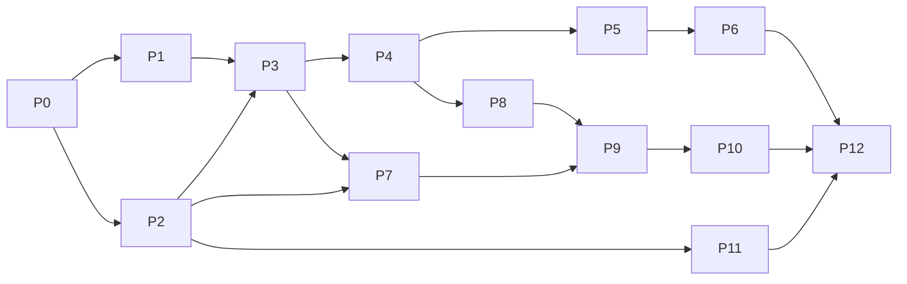

# OrderBuddy Screen Manager — v2 Development Plan (Tracking)

> **Purpose:** A granular, checkbox-driven execution plan to build v2 from zero to production. Companion to [DESIGN.md](DESIGN.md).
> **How to use:** Work top-to-bottom by phase. Tick each task `[x]` when its acceptance criteria pass. Keep the **Progress Dashboard** (§1) and **Change Log** (§13) current. Do not start a phase until its listed dependencies are done.
> **Legend:** ☐ not started · ◐ in progress · ☑ done · ⚠ blocked. Priority: **P0** critical path · **P1** important · **P2** nice-to-have.

---

## 1. Progress dashboard

| Phase | Focus | Tasks | Status | Exit gate |
|---|---|---:|---|---|
| P0 | Project bootstrap & tooling | 6 | ☑ 6/6 | Repo builds & runs empty WPF app |
| P1 | Spike: WebView2 kiosk window | 7 | ☑ 7/7 | URL renders full-screen + reload on crash |
| P2 | Config service & schema | 8 | ☑ 8/8 | Load/validate/save/migrate/backup proven |
| P3 | Multi-display core | 8 | ☐ 0/8 | N monitors → N windows, stable-key binding |
| P4 | Kiosk lockdown & security | 9 | ☐ 0/9 | Cannot exit; nav locked; single instance |
| P5 | Health monitoring & recovery | 9 | ☐ 0/9 | All injected faults self-heal, no thrash |
| P6 | Fallback & offline behaviour | 7 | ☐ 0/7 | Branded fallback + correct offline cause |
| P7 | Admin UX (wizard + Display Wall) | 10 | ☐ 0/10 | Non-tech user configures 3 screens unaided |
| P8 | Startup integration & lifecycle | 6 | ☐ 0/6 | Auto-start, restart-on-crash, sleep/resume |
| P9 | Packaging & installer | 7 | ☐ 0/7 | Signed silent MSI + WebView2 bootstrap |
| P10 | Auto-update & hardening | 6 | ☐ 0/6 | Signed delta update + rollback verified |
| P11 | Remote-ready hooks (optional) | 5 | ☐ 0/5 | Config pull behind flag, no regression |
| P12 | QA, soak & release | 8 | ☐ 0/8 | Full test matrix green; 72h soak passes |
| **Total** | | **96** | **◐ 21/96** | Production release |

> Update the counts as tasks complete (e.g. `◐ 3/8`).

---

## 2. Definition of Done (applies to every task)
- [ ] Code compiles with no warnings introduced.
- [ ] Behaviour matches the task's acceptance criteria.
- [ ] Logged appropriately (Serilog) with correct level.
- [ ] Manual verification steps executed on at least one real/VM device.
- [ ] No regressions in the phase's exit-gate scenario.
- [ ] Config/docs updated if behaviour or schema changed.

---

## 3. Phase P0 — Project bootstrap & tooling  `depends: none`

**Goal:** A clean, buildable .NET 8 WPF solution with logging, DI, and repo hygiene.

- [x] **P0-1 (P0)** Create solution `OrderBuddy.ScreenManager.sln`; projects: `ScreenManager.App` (WPF, net8.0-windows), `ScreenManager.Core` (class lib), `ScreenManager.Tests` (xUnit).
  - *Accept:* `dotnet build` succeeds; empty WPF window shows.
- [x] **P0-2 (P0)** Add NuGet deps: `Microsoft.Web.WebView2`, `Serilog`, `Serilog.Sinks.File`, `Serilog.Sinks.EventLog`, `Microsoft.Extensions.Hosting` (DI/host), `System.Text.Json`.
  - *Accept:* restore succeeds; versions pinned in `Directory.Packages.props`.
- [x] **P0-3 (P0)** Set up generic host + DI container; register `IConfigService`, `IDisplayManager`, `IHealthMonitor`, `ILogger` placeholders.
  - *Accept:* app starts via host; DI resolves stubs.
- [x] **P0-4 (P1)** Configure Serilog: rolling file to `%ProgramData%\OrderBuddy\ScreenManager\logs`, level from config, Event Log sink for errors.
  - *Accept:* startup writes a log line; file rotates by day/size.
- [x] **P0-5 (P1)** Repo hygiene: `.gitignore` (bin/obj/publish), `.editorconfig`, `Directory.Build.props` (nullable enable, LangVersion, versioning), README stub.
  - *Accept:* clean `git status` after build; analyzers on.
- [x] **P0-6 (P2)** CI stub (GitHub Actions / local script): restore → build → test.
  - *Accept:* pipeline/script runs green on empty tests.

**Exit gate:** solution builds and runs an empty WPF window with logging active.

---

## 4. Phase P1 — Spike: WebView2 kiosk window  `depends: P0`

**Goal:** Prove the core stack — a borderless full-screen WebView2 that loads a URL and survives a renderer crash.

- [x] **P1-1 (P0)** `KioskWindow` (WPF): borderless (`WindowStyle=None`), no resize, top-most, full-screen on primary monitor.
  - *Accept:* window covers one monitor edge-to-edge, no chrome.
- [x] **P1-2 (P0)** Host `WebView2` control filling the window; init `CoreWebView2` with a per-app user-data folder under `%ProgramData%`.
  - *Accept:* a hard-coded URL renders full-screen.
- [x] **P1-3 (P0)** Handle `CoreWebView2.ProcessFailed`: log, then recreate/reload WebView2.
  - *Accept:* killing the WebView2 renderer process auto-recovers the page.
- [x] **P1-4 (P1)** Handle `NavigationCompleted`: capture success/failure + web error status.
  - *Accept:* bad URL logs a navigation failure with status.
- [x] **P1-5 (P1)** Disable default context menu, dev tools, status bar, zoom-by-ctrl-scroll via `CoreWebView2Settings`.
  - *Accept:* right-click shows nothing; F12 does nothing.
- [x] **P1-6 (P1)** Verify autoplay media works (no gesture requirement) via launch args/settings.
  - *Accept:* a test autoplay video plays without interaction.
- [x] **P1-7 (P2)** Measure cold-start time and idle memory; record baseline in Change Log.
  - *Accept:* numbers recorded for later comparison.

**Exit gate:** URL renders full-screen; renderer crash auto-recovers.

---

## 5. Phase P2 — Config service & schema  `depends: P0`

**Goal:** Robust, versioned configuration with validation, atomic writes, backup, migration, hot-reload. Schema per DESIGN §3.6.

- [x] **P2-1 (P0)** Define POCO models: `AppConfig`, `DeviceInfo`, `GeneralSettings`, `ScreenConfig`, `FallbackConfig`, `AppType` enum.
  - *Accept:* serializes/deserializes round-trip with `System.Text.Json`.
- [x] **P2-2 (P0)** `IConfigService.Load()`: read from `%ProgramData%\OrderBuddy\ScreenManager\config.json`; create defaults if missing.
  - *Accept:* first run writes a valid default config.
- [x] **P2-3 (P0)** Schema validation (required fields, URL format, ranges); collect errors, don't throw on minor issues.
  - *Accept:* invalid values reported; safe defaults substituted.
- [x] **P2-4 (P0)** Atomic save (write temp file + `File.Replace`/rename); never leave partial file.
  - *Accept:* killing process mid-save leaves prior config intact.
- [x] **P2-5 (P0)** Last-known-good backup: keep `config.bak`; on corrupt load, restore from backup then defaults.
  - *Accept:* corrupt `config.json` → app boots from backup, logs loudly.
- [x] **P2-6 (P1)** Version migration pipeline (`schemaVersion` upgrader chain).
  - *Accept:* a v1-shaped file migrates to current schema.
- [x] **P2-7 (P1)** Hot-reload via `FileSystemWatcher` (debounced); raise `ConfigChanged`.
  - *Accept:* external edit re-applies without restart.
- [x] **P2-8 (P1)** Secrets protection: PIN hash via PBKDF2 (salted) or DPAPI; secrets section not plaintext.
  - *Accept:* config file contains no plaintext PIN.

**Exit gate:** load/validate/save/migrate/backup/hot-reload all proven by tests.

---

## 6. Phase P3 — Multi-display core  `depends: P1, P2`

**Goal:** Enumerate monitors, bind by stable key, one window per enabled screen, react to hot-plug.

- [ ] **P3-1 (P0)** `IDisplayManager.Enumerate()`: list monitors with bounds, work area, DPI, resolution, orientation.
  - *Accept:* returns correct data on a multi-monitor machine.
- [ ] **P3-2 (P0)** Derive **stable display key** (EDID target id / device path) with position+resolution fallback.
  - *Accept:* same monitor yields same key across reboots/replug.
- [ ] **P3-3 (P0)** `KioskSupervisor`: create one `KioskWindow` per enabled screen, placed on its target monitor bounds.
  - *Accept:* 3 monitors → 3 windows, each on the right screen with the right URL.
- [ ] **P3-4 (P0)** Bind config `displayKey` → live monitor; unmatched enabled screens show fallback "waiting for display".
  - *Accept:* assignments follow the monitor, not the index.
- [ ] **P3-5 (P1)** Subscribe to `WM_DISPLAYCHANGE` / display device notifications.
  - *Accept:* plug/unplug fires an event within ~1s.
- [ ] **P3-6 (P1)** Monitor removed at runtime → close/hide that window, retain assignment, log.
  - *Accept:* unplugging a monitor doesn't crash; others unaffected.
- [ ] **P3-7 (P1)** Monitor added at runtime → auto-open window if saved assignment matches, else leave for admin.
  - *Accept:* replugging restores the correct window automatically.
- [ ] **P3-8 (P1)** Per-screen rotation/orientation + zoom applied at window/WebView2 level.
  - *Accept:* a portrait screen and a zoomed screen render correctly.

**Exit gate:** N monitors → N correctly-bound windows; survives reorder/replug.

---

## 7. Phase P4 — Kiosk lockdown & security  `depends: P3`

**Goal:** Make the kiosk tamper-resistant; prevent accidental exit; lock navigation; single instance.

- [ ] **P4-1 (P0)** Single-instance guard via named `Mutex`; second launch exits quietly (log).
  - *Accept:* launching twice yields one running instance.
- [ ] **P4-2 (P0)** Suppress browser accelerator keys (F5, Ctrl+R, back/forward, Ctrl+P unless allowed) via WebView2 accelerator-key handler.
  - *Accept:* those keys do nothing in kiosk mode.
- [ ] **P4-3 (P0)** Block Alt+F4 / close; intercept `Window.Closing` unless admin-authorised exit.
  - *Accept:* Alt+F4 does not close kiosk windows.
- [ ] **P4-4 (P0)** Global low-level keyboard hook (optional, config-gated) to swallow Win key / Ctrl+Esc.
  - *Accept:* Win key doesn't drop to desktop when enabled.
- [ ] **P4-5 (P0)** Navigation lockdown: optional domain allow-list; block/redirect off-list + `file:`/`about:`.
  - *Accept:* off-list link is blocked and logged.
- [ ] **P4-6 (P0)** New-window/popup policy: redirect to same window or block per config.
  - *Accept:* `target=_blank` doesn't spawn an uncontrolled window.
- [ ] **P4-7 (P1)** Per-screen permission auto-grant (media/geo/notification/clipboard) via `PermissionRequested`.
  - *Accept:* camera/mic/geo prompts auto-resolve per config.
- [ ] **P4-8 (P1)** Config file ACL: restrict write to Administrators/SYSTEM.
  - *Accept:* standard user cannot modify config file.
- [ ] **P4-9 (P1)** SSL/cert error policy: reject by default; per-screen opt-in "allow insecure" (logged).
  - *Accept:* self-signed site blocked unless opted-in.

**Exit gate:** cannot exit or navigate away without authorisation; one instance only.

---

## 8. Phase P5 — Health monitoring & recovery  `depends: P4`

**Goal:** Layered detection + capped-backoff recovery for every failure class (DESIGN §3.5).

- [ ] **P5-1 (P0)** `IHealthMonitor` per screen: track state (Loading/Online/Recovering/Offline/Failed).
  - *Accept:* state transitions logged and queryable.
- [ ] **P5-2 (P0)** JS **heartbeat**: inject script posting a message every N s; missing beats = frozen page.
  - *Accept:* freezing the page (blocking JS) is detected within threshold.
- [ ] **P5-3 (P0)** Nav/HTTP error handling → **exponential backoff** retry `[5,10,30,60]` capped.
  - *Accept:* bad URL retries with increasing delay, never tight-loops.
- [ ] **P5-4 (P0)** Renderer crash (`ProcessFailed`) → reinit WebView2 + reload; per-window failure counter.
  - *Accept:* repeated kills recover; counter increments, no thrash.
- [ ] **P5-5 (P0)** Retry-limit escalation → hold on fallback + slow probe (15–30s), auto-reload on recovery.
  - *Accept:* after cap, screen holds fallback and self-recovers later.
- [ ] **P5-6 (P1)** Connectivity watchdog (see P6) integration: network-down → fallback, not retry-thrash.
  - *Accept:* pulling the cable shows fallback, restores on reconnect.
- [ ] **P5-7 (P1)** Optional memory watchdog: working-set threshold → reload window (or defer to nightly).
  - *Accept:* exceeding threshold triggers a controlled reload.
- [ ] **P5-8 (P1)** Nightly maintenance window: scheduled reload-all (or reboot) at quiet time.
  - *Accept:* at configured time, screens reload cleanly.
- [ ] **P5-9 (P2)** Per-screen reload interval (if set) honoured without disrupting healthy pages.
  - *Accept:* a 300s reload-interval screen refreshes on schedule.

**Exit gate:** all injected faults (bad URL, kill renderer, freeze JS, pull network) self-heal without thrash.

---

## 9. Phase P6 — Fallback & offline behaviour  `depends: P5`

**Goal:** Branded in-app fallback overlay + accurate offline-cause detection.

- [ ] **P6-1 (P0)** WPF fallback overlay layered over WebView2: logo, device/screen name, connection state, last-connected, retry countdown, progress.
  - *Accept:* overlay renders with zero network; matches DESIGN §4.5.
- [ ] **P6-2 (P0)** Show/hide fallback driven by `IHealthMonitor` state; auto-dismiss on reconnect.
  - *Accept:* fallback appears on failure, disappears on recovery.
- [ ] **P6-3 (P0)** Connectivity signals: (a) internet HTTP probe (captive-portal aware), (b) local app-origin HEAD.
  - *Accept:* both signals reported independently in logs.
- [ ] **P6-4 (P1)** Fallback message names the specific cause (internet vs local server).
  - *Accept:* server-down (internet up) shows "server" message.
- [ ] **P6-5 (P1)** Auto-reload triggers only when the *relevant* signal recovers.
  - *Accept:* internet-only outage doesn't reload a healthy local page.
- [ ] **P6-6 (P2)** Optional custom fallback modes: custom HTML file / image (carry v1 capability).
  - *Accept:* custom HTML/image renders when selected.
- [ ] **P6-7 (P2)** "Last successful connection" timestamp persisted per screen.
  - *Accept:* value survives a reload and shows correctly.

**Exit gate:** branded fallback shows the correct cause and self-recovers on reconnect.

---

## 10. Phase P7 — Admin UX (wizard + Display Wall)  `depends: P2, P3`

**Goal:** Visual, guided, touch-first configuration (DESIGN §4). The biggest UX win over v1.

- [ ] **P7-1 (P0)** Admin access triggers: corner tap-5×-in-3s gesture **and** `Ctrl+Shift+F12` → open PIN pad.
  - *Accept:* both paths open the PIN prompt on touch-only and keyboard devices.
- [ ] **P7-2 (P0)** On-screen numeric **PIN pad**; verify against PBKDF2/DPAPI hash; lockout with backoff.
  - *Accept:* correct PIN unlocks; wrong PIN locks out progressively.
- [ ] **P7-3 (P0)** Settings shell (MVVM) with tabs: **Displays · General · Advanced · Diagnostics · About**.
  - *Accept:* navigation works; unsaved-changes guard present.
- [ ] **P7-4 (P0)** **Display Wall**: visual monitor tiles mirroring physical layout with live status dots.
  - *Accept:* tiles match real monitor arrangement and online/offline state.
- [ ] **P7-5 (P0)** Per-screen editor: app type, enable, full-screen, URL, rotation, zoom, reload interval, startup delay, fallback.
  - *Accept:* edits persist via ConfigService and apply live.
- [ ] **P7-6 (P1)** **App-type presets** pre-fill sensible defaults (KDS/Till/Menu/etc.).
  - *Accept:* choosing "KDS" sets its default options.
- [ ] **P7-7 (P1)** **Test URL** button: validate reachability + SSL before save.
  - *Accept:* unreachable/invalid URL is flagged before saving.
- [ ] **P7-8 (P1)** **Identify screens**: flash big number/label on each monitor.
  - *Accept:* correct number appears on each physical screen.
- [ ] **P7-9 (P1)** **First-run wizard**: Welcome → Device info → Assign displays → URLs & options → Review → Lock.
  - *Accept:* completes a clean 3-screen setup end-to-end.
- [ ] **P7-10 (P1)** **Diagnostics** tab: live per-screen state, uptime, memory, view logs, export support bundle, restart-all, connectivity test.
  - *Accept:* support bundle zip exports logs + config (redacted secrets).

**Exit gate:** a non-technical tester configures a 3-screen device unaided.

---

## 11. Phase P8 — Startup integration & lifecycle  `depends: P4`

**Goal:** Auto-start, restart-on-crash, survive reboot/sleep/power loss.

- [ ] **P8-1 (P0)** Auto-start registration: Scheduled Task (at log-on, highest privileges, restart-on-failure) or `HKLM\...\Run`; toggle from settings.
  - *Accept:* app launches automatically after login.
- [ ] **P8-2 (P0)** App-crash restart: task restart-on-failure policy verified.
  - *Accept:* killing the app process relaunches it automatically.
- [ ] **P8-3 (P0)** Deterministic restore from config after any restart (all enabled screens return).
  - *Accept:* post-restart state matches pre-crash state.
- [ ] **P8-4 (P1)** Sleep/resume handling: revalidate displays, reconnect, reload stale pages, reassert top-most.
  - *Accept:* after resume, all screens are correct and top-most.
- [ ] **P8-5 (P1)** Simulated power-loss recovery (hard reset VM) → clean boot into kiosk.
  - *Accept:* device returns to kiosk unattended.
- [ ] **P8-6 (P2)** Optional Windows Service watchdog (pre-login) — design stub only, behind a flag.
  - *Accept:* documented; disabled by default; no regression when off.

**Exit gate:** unattended device auto-starts, restarts on crash, recovers from sleep/power loss.

---

## 12. Phase P9 — Packaging & installer  `depends: P7, P8`

**Goal:** Signed, silent, per-machine MSI that chains the WebView2 bootstrapper.

- [ ] **P9-1 (P0)** `dotnet publish` profile: single-file, self-contained (or framework-dependent + runtime check), trimmed where safe.
  - *Accept:* published app runs on a clean VM.
- [ ] **P9-2 (P0)** WiX v4 MSI: install to `Program Files`, create `%ProgramData%` config dir with ACLs, register Scheduled Task/Run.
  - *Accept:* silent `msiexec /i /qn` installs and boots kiosk.
- [ ] **P9-3 (P0)** Chain **WebView2 Evergreen Bootstrapper**; install/repair runtime if missing.
  - *Accept:* clean VM without WebView2 gets it installed by the MSI.
- [ ] **P9-4 (P0)** **Code-sign** app binaries + MSI with the org certificate.
  - *Accept:* signature valid; SmartScreen/AV don't flag on target images.
- [ ] **P9-5 (P1)** Clean uninstall: remove app, task, registry; optionally preserve config (prompt/flag).
  - *Accept:* uninstall leaves no orphan task/keys.
- [ ] **P9-6 (P1)** Upgrade path: MSI major-upgrade preserves config and migrates schema.
  - *Accept:* upgrading over an older version keeps settings.
- [ ] **P9-7 (P2)** Installer UX: minimal UI + fully silent switches documented for fleet deployment.
  - *Accept:* deployment doc lists silent flags.

**Exit gate:** signed silent MSI installs on a clean device and boots into kiosk.

---

## 13. Phase P10 — Auto-update & hardening  `depends: P9`

**Goal:** Unattended signed updates with rollback; final security pass.

- [ ] **P10-1 (P0)** Integrate updater (Velopack/Squirrel) or MSI-pull updater; signed packages only.
  - *Accept:* app detects and applies a newer signed release.
- [ ] **P10-2 (P0)** Silent apply + relaunch during quiet window; no user interaction.
  - *Accept:* update installs unattended and restores screens.
- [ ] **P10-3 (P0)** **Rollback** on failed update (bad package / failed health after update).
  - *Accept:* a deliberately-broken update rolls back to prior version.
- [ ] **P10-4 (P1)** Update integrity: verify signature/hash before applying.
  - *Accept:* tampered package is rejected.
- [ ] **P10-5 (P1)** Security review pass: config ACLs, secrets, nav lockdown, exit protection, logging redaction.
  - *Accept:* checklist in DESIGN §5/§8.2 all pass.
- [ ] **P10-6 (P2)** Threat-model note + dependency vulnerability scan.
  - *Accept:* no high-severity dependency CVEs; notes recorded.

**Exit gate:** signed delta update applies unattended; rollback verified.

---

## 14. Phase P11 — Remote-ready hooks (optional)  `depends: P2`

**Goal:** Keep remote management a drop-in without building the backend now.

- [ ] **P11-1 (P1)** Config is a stable serializable contract (versioned DTOs, no local-only coupling).
  - *Accept:* config DTOs serialize cleanly for transport.
- [ ] **P11-2 (P2)** Pull-based config sync client (behind feature flag): fetch signed config from an endpoint, validate, apply.
  - *Accept:* device pulls remote config when flag on; ignores when off.
- [ ] **P11-3 (P2)** Device registration stub: device id, store id, org id payload.
  - *Accept:* registration payload logged/prepared; no backend required.
- [ ] **P11-4 (P2)** Heartbeat/telemetry sink interface (pluggable, no-op default).
  - *Accept:* interface exists; default does nothing; no overhead.
- [ ] **P11-5 (P2)** Remote command stub (reload/restart) design note only.
  - *Accept:* documented; not implemented; no attack surface added.

**Exit gate:** remote hooks present behind flags; zero regression when disabled.

---

## 15. Phase P12 — QA, soak & release  `depends: all`

**Goal:** Execute the full validation matrix (DESIGN §8) and ship.

- [ ] **P12-1 (P0)** Run **Displays** checklist (DESIGN §8.1) on 1/2/3/4-monitor rigs incl. portrait & mixed DPI.
- [ ] **P12-2 (P0)** Run **Kiosk & security** checklist (§8.2) on touch-only and keyboard devices.
- [ ] **P12-3 (P0)** Run **Recovery** checklist (§8.3) with automated fault injection (kill renderer, bad URL, freeze).
- [ ] **P12-4 (P0)** Run **Offline & network** checklist (§8.4) incl. captive portal + server-only outage.
- [ ] **P12-5 (P0)** Run **Startup & lifecycle** checklist (§8.5) incl. power-loss & sleep/resume.
- [ ] **P12-6 (P0)** Run **Config & UX** checklist (§8.6) incl. corrupt-config & non-tech usability test.
- [ ] **P12-7 (P0)** Run **Packaging & update** checklist (§8.7) on clean images.
- [ ] **P12-8 (P0)** **72-hour multi-screen soak** (§8.8): memory/CPU stable, auto fault-injection green → tag release.

**Exit gate:** full matrix green; soak passes; signed release tagged & documented.

---

## 16. Dependency graph (phase level)

---

## 17. Critical path & sequencing notes
- **Critical path:** P0 → P1 → P3 → P4 → P5 → P6 → P9 → P10 → P12. Keep these unblocked first.
- **Parallelisable:** P2 (config) alongside P1; P7 (Admin UX) can start once P2+P3 exist; P11 is optional and can trail.
- **Do not skip P5/P6 before packaging** — reliability is the product's core promise.
- **Sign early (P9-4):** establish code-signing before wide testing to build AV/SmartScreen reputation.

---

## 18. Risk register (live — update as risks change)

| ID | Risk | Phase | L | I | Mitigation | Status |
|---|---|---|---|---|---|---|
| R1 | WebView2 runtime missing on old images | P9 | M | H | Chain bootstrapper; detect+repair | ☐ open |
| R2 | Display hot-plug identity instability | P3 | M | M | Stable EDID/device-path key + fallback | ☐ open |
| R3 | Retry storms / CPU spin | P5 | L | H | Capped exponential backoff by design | ☐ open |
| R4 | AV/SmartScreen false-positive | P9 | M | M | Code-sign early; build reputation | ☐ open |
| R5 | Long-run memory leak in web apps | P5 | M | M | Memory watchdog + nightly reload | ☐ open |
| R6 | Pre-login launch requirement emerges | P8 | L | M | Service watchdog option (P8-6) | ☐ open |
| R7 | Scope creep to remote mgmt too early | P11 | M | M | Keep behind flags; ship local-first | ☐ open |
| R8 | Global key hook conflicts / instability | P4 | L | M | Config-gate the hook; test per device | ☐ open |

---

## 19. Milestone → phase mapping (from DESIGN §7.1)

| DESIGN milestone | Plan phases |
|---|---|
| M0 Spike | P0, P1 |
| M1 Multi-display core | P2, P3 |
| M2 Kiosk lockdown | P4 |
| M3 Recovery & health | P5 |
| M4 Fallback & offline | P6 |
| M5 Admin UX | P7 |
| M6 Packaging | P8, P9 |
| M7 Update & hardening | P10 |
| M8 Remote-ready | P11 |
| Release | P12 |

---

## 20. Change log (append newest at top)

| Date | Phase/Task | Change / decision | By |
|---|---|---|---|
| 2026-07-13 | — | Development plan created from DESIGN.md | — |
| 2026-07-13 | P0 complete | All 6 tasks done. Solution: 3 projects (App/Core/Tests). Build: 0 errors/0 warnings (Debug + Release). Tests: 6/6 passed. Added `Serilog.Extensions.Hosting` (missing from initial pinning). Removed `Class1.cs` stub. DI host + Serilog rolling file + EventLog sink wired. `Directory.Packages.props` central versioning active. `.editorconfig`/`.gitignore`/`Directory.Build.props`/`README.md`/`.github/workflows/ci.yml` all present. | — |
| 2026-07-14 | P1 complete | Implemented `KioskWindow` full-screen borderless top-most on primary monitor with embedded WebView2 and shared environment provider. WebView2 user-data path: `%ProgramData%\OrderBuddy\ScreenManager\webview2`. Applied settings lockdown (context menu/devtools/statusbar/zoom disabled). Added autoplay arg `--autoplay-policy=no-user-gesture-required`. Added `NavigationCompleted` logging with success/error status. Added `ProcessFailed` recovery (reinitialize + reload) and fixed crash-path cleanup bug discovered during forced browser-process kill test. Validation: Build 0 errors/0 warnings, tests 6/6 passed. Runtime evidence in logs: successful navigation (HTTP 200), forced process failure detected and recovered. Baseline metrics: ColdStartMs 1305, idle WorkingSet ~95.38 MB. | — |
| 2026-07-14 | P2 complete | Replaced config stub with full `ConfigService` + schema models. Implemented load/create-default, validation+normalization diagnostics, atomic save (`File.Replace`), backup restore fallback, legacy v1 migration path, debounced hot-reload (`FileSystemWatcher` + `ConfigChanged`), and PBKDF2 PIN hashing protection. Wired app DI to use real `ConfigService` with `%ProgramData%\OrderBuddy\ScreenManager\config.json`. Validation via tests: round-trip serialization, missing config default creation, invalid value normalization, atomic save/backup, corrupt primary fallback to backup, legacy migration, hot-reload event, and no plaintext PIN persistence. Final validation: Release build 0 errors/0 warnings, tests 14/14 passed. | — |

> Add a row whenever a task completes, a decision changes, or a baseline/metric is recorded (e.g. P1-7 cold-start numbers).
